# Domzli · Documento de Arquitectura Técnica (TAD)

| Campo | Valor |
|---|---|
| Versión | 1.0 — borrador para revisión |
| Fecha | 17 de noviembre de 2026 |
| Documento fuente | [Plan de producto y arquitectura v2.0](../product/plan-producto-v2.md) |
| Documentos relacionados | [Especificación del Design System](../design-system/design-system-spec.md) · [Registro de decisiones (ADR)](../decisions/README.md) |
| Alcance | Fases 1 y 2 (MVP) en detalle. Fases 3 y 4 como puntos de extensión |
| Estado | Propuesto. Requiere aprobación antes de iniciar la Fase 1 |

---

## Índice

1. [Cómo leer este documento](#1-cómo-leer-este-documento)
2. [Impulsores arquitectónicos](#2-impulsores-arquitectónicos)
3. [Vista de contexto (C4 · nivel 1)](#3-vista-de-contexto-c4--nivel-1)
4. [Vista de contenedores (C4 · nivel 2)](#4-vista-de-contenedores-c4--nivel-2)
5. [Vista de componentes (C4 · nivel 3)](#5-vista-de-componentes-c4--nivel-3)
6. [Arquitectura del cliente](#6-arquitectura-del-cliente)
7. [Autenticación e identidad](#7-autenticación-e-identidad)
8. [Autorización y seguridad (RLS)](#8-autorización-y-seguridad-rls)
9. [Modelo de datos](#9-modelo-de-datos)
10. [Flujos de negocio críticos](#10-flujos-de-negocio-críticos)
11. [Procesos en segundo plano e integraciones](#11-procesos-en-segundo-plano-e-integraciones)
12. [Entornos, CI/CD y despliegue](#12-entornos-cicd-y-despliegue)
13. [Observabilidad, respaldo y operación](#13-observabilidad-respaldo-y-operación)
14. [Estrategia de pruebas](#14-estrategia-de-pruebas)
15. [Decisiones técnicas (índice de ADR)](#15-decisiones-técnicas-índice-de-adr)
16. [Decisiones de negocio pendientes: recomendación técnica](#16-decisiones-de-negocio-pendientes-recomendación-técnica)
17. [Riesgos](#17-riesgos)
18. [Cambios propuestos respecto al plan v2.0](#18-cambios-propuestos-respecto-al-plan-v20)
19. [Glosario](#19-glosario)

---

## 1. Cómo leer este documento

- Los diagramas siguen la notación **C4** (contexto, contenedores, componentes) y se escriben en **Mermaid**, para que GitHub los muestre y se puedan versionar como texto.
- Los identificadores técnicos (tablas, columnas, funciones) están en **inglés**. La documentación y la interfaz están en **español de Colombia**.
- Cada decisión con alternativas reales tiene un **ADR** en [`docs/decisions/`](../decisions/README.md). Este documento resume y enlaza; el ADR conserva el razonamiento.
- Las marcas **F1–F4** indican la fase del roadmap en la que se implementa cada elemento.
- ⚖️ marca los puntos que requieren **validación jurídica o contable** antes de implementarse.

---

## 2. Impulsores arquitectónicos

### 2.1. Atributos de calidad priorizados

| # | Atributo | Escenario verificable | Tácticas principales |
|---|---|---|---|
| Q1 | **Aislamiento entre organizaciones** | Un usuario autenticado de la organización A que modifique a mano una petición a la API no lee ni altera ninguna fila de la organización B. | RLS en todas las tablas, FK compuestas `(organization_id, id)`, pruebas pgTAP negativas por tabla y rol. |
| Q2 | **Integridad financiera** | Dos aprobaciones simultáneas del mismo pago, o dos ejecuciones simultáneas del generador de cobros, producen un único efecto. | Escrituras financieras solo vía RPC transaccional, `SELECT … FOR UPDATE`, índices únicos, idempotencia, *advisory locks*. |
| Q3 | **Trazabilidad** | Toda modificación de contratos, cobros, pagos y membresías registra actor, fecha y valores anteriores y nuevos. | `audit_logs` *append-only* alimentada por triggers y RPC. |
| Q4 | **Rendimiento en gama media** | Listado de 200 inmuebles: p95 < 1,5 s en 4G. Dashboard: p95 < 2 s. Desplazamiento a 60 fps. | Índices, vistas agregadas, paginación por rango, selección explícita de columnas, FlashList, `expo-image`. |
| Q5 | **Tolerancia a conectividad inestable** | Sin red, el usuario consulta los últimos datos sincronizados. Ninguna operación financiera se confirma sin respuesta del backend. | Caché persistida de TanStack Query, `networkMode: 'online'` en mutaciones, sin actualizaciones optimistas financieras. |
| Q6 | **Evolución hacia SaaS** | Añadir un rol, un plan o un tipo de organización no exige migrar los datos existentes ni reescribir pantallas. | Multi-organización desde el día 1, roles como datos, autorización centralizada en funciones auxiliares. |
| Q7 | **Accesibilidad** | WCAG 2.2 AA en web. Lectores de pantalla (VoiceOver/TalkBack) funcionales en los flujos críticos. | Design System con roles ARIA, contraste verificado, objetivos táctiles ≥ 44 pt. |
| Q8 | **Código compartido** | ≥ 85 % del código de UI y lógica compartido entre iOS, Android y Web (meta, no restricción). | Expo + React Native Web, archivos `.web.tsx`/`.native.tsx` solo donde haga falta. |

### 2.2. Restricciones

- **Stack definido** por el plan v2.0: Expo, React Native, TypeScript, NativeWind, TanStack Query, Supabase.
- **Sin servidor de aplicaciones propio**: el backend es Supabase (PostgreSQL, Auth, Storage, Edge Functions).
- **Claves privilegiadas nunca en el cliente** (clave secreta / `service_role`).
- **Mercado colombiano**: moneda COP, configuración regional `es-CO`, zona horaria `America/Bogota` (UTC−5, sin horario de verano), Ley 1581 de 2012 (protección de datos personales) y Ley 820 de 2003 (arrendamiento de vivienda urbana).
- **Políticas de las tiendas**: eliminación de cuenta desde la app (Apple y Google) y *Sign in with Apple* obligatorio en iOS si se ofrece inicio de sesión con terceros.
- **Equipo pequeño**: se prefiere la solución más simple que cumpla los atributos de calidad (principio 10 del plan).

### 2.3. Supuestos

| Supuesto | Implicación | Si deja de cumplirse |
|---|---|---|
| < 100 organizaciones y < 5.000 inmuebles durante los primeros 12 meses | El plan Pro de Supabase es suficiente; no se requiere particionamiento. | Revisar índices, vistas materializadas y tamaño de cómputo. |
| Una sola moneda por organización (COP) | `organizations.currency` fija; no hay conversión. | Añadir moneda por contrato y tasas de cambio. |
| Una sola zona horaria de negocio (`America/Bogota`) | Las fechas de negocio (vencimientos, períodos) se calculan en esa zona. | Usar `organizations.timezone` en todos los cálculos (la columna ya existe). |
| Los pagos del MVP son reportados manualmente | No hay conciliación bancaria automática. | Fase 3: pasarela con webhooks. |

---

## 3. Vista de contexto (C4 · nivel 1)

Domzli es un único sistema de software usado por tres tipos de persona y apoyado en servicios externos. Las líneas discontinuas son integraciones de fases posteriores.

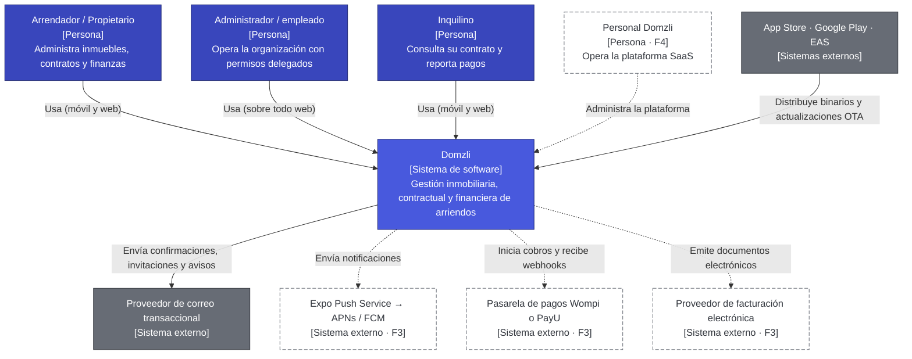

| Actor / sistema | Interacción principal | Fase |
|---|---|---|
| Arrendador / Propietario | Registra inmuebles, inquilinos y contratos; revisa pagos; consulta finanzas. Rol `owner`. | F1 |
| Administrador / empleado | Igual que el propietario dentro de lo que la organización le permita. Rol `admin`. | F1 (rol) · F4 (permisos finos) |
| Inquilino | Consulta su contrato y obligaciones; reporta pagos con comprobante. Rol `tenant`. | F1 |
| Personal Domzli | Panel interno: organizaciones, planes, soporte. Fuera de las membresías. | F4 |
| Proveedor de correo | Correos de Auth (confirmación, recuperación) y de negocio (invitaciones, avisos). | F1 |
| Expo Push Service | Notificaciones push a iOS y Android. | F3 |
| Pasarela de pagos | Cobro en línea y confirmación por webhook. | F3 |
| Facturación electrónica | Emisión de documentos electrónicos cuando aplique. ⚖️ | F3 |

---

## 4. Vista de contenedores (C4 · nivel 2)

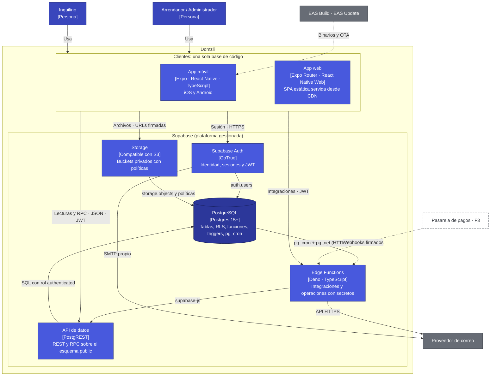

| Contenedor | Tecnología | Responsabilidad | No hace |
|---|---|---|---|
| **App móvil** | Expo (última SDK estable), React Native, Expo Router, NativeWind, TanStack Query | Experiencia mobile-first para arrendador e inquilino. Almacena la sesión de forma segura. | Calcular saldos con autoridad, generar cobros, aplicar autorización. |
| **App web** | La misma base de código exportada con `expo export -p web` (SPA) | Experiencia de escritorio: barra lateral, tablas, gestión masiva, exportaciones. | Tener backend propio (no se desarrolla un segundo backend). |
| **Supabase Auth** | GoTrue | Registro, confirmación de correo, inicio de sesión, recuperación, emisión y renovación de JWT. | Almacenar roles de negocio (viven en `memberships`). |
| **API de datos** | PostgREST | Exponer tablas y vistas del esquema `public` (lectura con RLS) y funciones RPC (comandos). | Exponer el esquema `private`. |
| **PostgreSQL** | Postgres gestionado por Supabase, `pg_cron`, `pg_net` | Fuente de verdad. Integridad (restricciones), autorización (RLS), reglas financieras (RPC), auditoría, procesos programados. | Llamar a proveedores externos directamente (lo delega en Edge Functions). |
| **Storage** | Supabase Storage | Fotos, contratos, comprobantes y soportes en buckets privados, con políticas sobre `storage.objects`. | Servir archivos públicos (no hay buckets públicos en el MVP). |
| **Edge Functions** | Deno, TypeScript | Operaciones que requieren secretos o integraciones: envío de invitaciones, despacho de notificaciones, eliminación de cuenta, webhooks (F3). | Contener reglas financieras (viven en la base de datos, ver [ADR-0005](../decisions/0005-logica-programada-en-postgres.md)). |

> **Realtime** queda fuera del MVP. Los cambios de estado (por ejemplo, un pago aprobado) se reflejan al recuperar el foco de la app o al refrescar. Se reevaluará cuando existan notificaciones push (F3).

---

## 5. Vista de componentes (C4 · nivel 3)

### 5.1. Cliente (app móvil y web)

La app aplica la separación de responsabilidades del plan (presentación, aplicación, dominio e infraestructura) **dentro de cada módulo funcional** (`src/features/*`). Las rutas (`src/app`) son delgadas: solo componen pantallas.

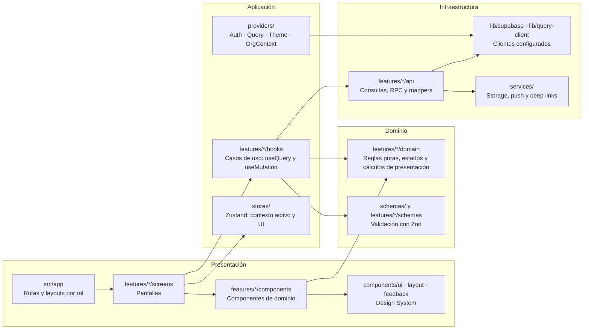

| Componente | Responsabilidad | Ejemplos |
|---|---|---|
| Rutas (`src/app`) | Mapear URL a pantalla, aplicar guardas de sesión y de rol, definir layouts (pestañas o barra lateral). | `(landlord)/_layout.tsx`, `invite/[token].tsx` |
| Pantallas (`features/*/screens`) | Componer componentes y hooks para una vista completa. Sin acceso directo a Supabase. | `PropertyListScreen`, `PaymentReviewScreen` |
| Componentes de dominio | Representar entidades del negocio a partir del Design System. | `PropertyCard`, `ChargeSummary` |
| Hooks de aplicación | Casos de uso: consultar, mutar, invalidar caché, mapear errores. | `useProperties`, `useReviewPayment` |
| Dominio | Reglas sin dependencias de React ni Supabase: estados derivados, etiquetas, cálculos de presentación. | `isLeaseExpiringSoon`, `chargeStatusTone` |
| Esquemas Zod | Validación de formularios y de entradas de RPC, compartida entre pantallas. | `propertyFormSchema`, `reportPaymentSchema` |
| API de feature | Única capa que habla con Supabase. Traduce filas (`snake_case`) a modelos (`camelCase`). | `fetchProperties`, `rpcReviewPayment` |
| Proveedores | Sesión, cliente de consultas, tema, organización activa. | `AuthProvider`, `OrgContextProvider` |

### 5.2. Backend (PostgreSQL en Supabase)

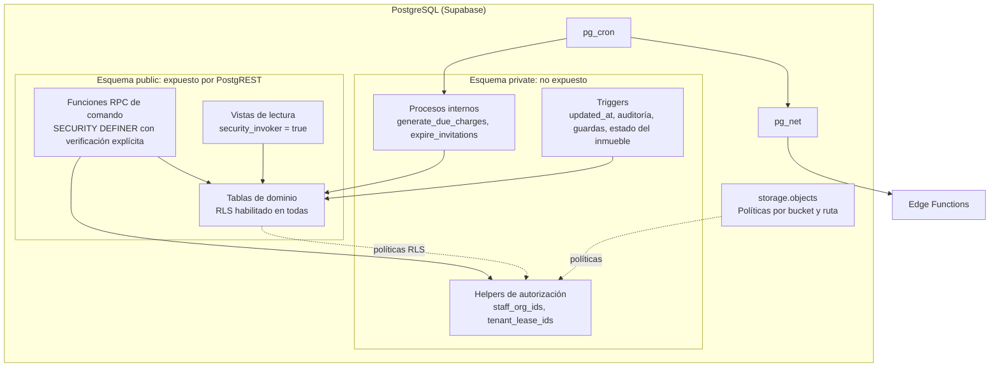

#### 5.2.1. Catálogo de funciones RPC (comandos)

Las lecturas se hacen directamente sobre tablas y vistas (con RLS). Las operaciones con reglas de negocio o efectos financieros se hacen **solo** mediante estas funciones ([ADR-0004](../decisions/0004-escrituras-financieras-via-rpc.md)).

| Función | Quién puede invocarla | Efecto | Fase |
|---|---|---|---|
| `create_organization(name, tax_id)` | Cualquier usuario autenticado | Crea la organización y la membresía `owner` en una transacción. | F1 |
| `my_contexts()` | Autenticado | Devuelve las organizaciones y roles del usuario para resolver la navegación. | F1 |
| `create_invitation(tenant_id)` | `owner`, `admin` | Crea la invitación (token de un solo uso, vigencia de 7 días) y revoca la anterior. | F1 |
| `get_invitation_preview(token)` | `anon` | Devuelve el nombre de la organización, el correo enmascarado y el estado. Nada más. | F1 |
| `accept_invitation(token)` | Autenticado con correo verificado igual al invitado | Crea la membresía `tenant` y vincula `tenants.profile_id`. | F1 |
| `revoke_invitation(invitation_id)` | `owner`, `admin` | Revoca una invitación pendiente. | F1 |
| `activate_lease(lease_id)` | `owner`, `admin` | Valida el borrador, lo activa y marca el inmueble como arrendado. | F1 |
| `terminate_lease(lease_id, end_date, reason)` | `owner`, `admin` | Finaliza el contrato sin borrar historial y libera el inmueble. | F1 |
| `renew_lease(lease_id, new_end_date)` | `owner`, `admin` | Extiende la vigencia y lo registra en la auditoría. | F1 |
| `apply_rent_adjustment(lease_id, effective_from, new_rent, reason)` | `owner`, `admin` | Registra un reajuste del canon (con tope legal en vivienda, ver P-2). | F2 |
| `generate_charges_for_lease(lease_id, until)` | `owner`, `admin` | Generación bajo demanda (por ejemplo, al activar un contrato). Idempotente. | F2 |
| `create_manual_charge(lease_id, due_date, items)` | `owner`, `admin` | Cobro extraordinario (por ejemplo, una reparación a cargo del inquilino). | F2 |
| `void_charge(charge_id, reason)` | `owner`, `admin` | Anula un cobro sin pagos aplicados. | F2 |
| `report_payment(lease_id, amount, paid_on, method, reference, receipt_path, allocations)` | Inquilino del contrato, `owner`, `admin` | Inquilino: crea un pago `in_review`. Staff: registra un pago directo `approved`. | F2 |
| `review_payment(payment_id, decision, reason)` | `owner`, `admin` | Aprueba (aplica a saldos) o rechaza (motivo obligatorio). | F2 |
| `reverse_payment(payment_id, reason)` | `owner` | Revierte un pago aprobado por error y restaura los saldos. | F2 |
| `get_dashboard_summary(organization_id, period)` | `owner`, `admin` | KPI del dashboard en una sola consulta. | F2 |

#### 5.2.2. Catálogo de Edge Functions

| Función | Disparador | Autenticación | Secretos | Fase |
|---|---|---|---|---|
| `send-invitation` | HTTP desde la app | JWT del usuario. Llama a `create_invitation` **con ese JWT**, de modo que la RLS y las verificaciones de la RPC aplican. | API key del proveedor de correo | F1 |
| `delete-account` | HTTP desde la app | JWT del usuario | Clave secreta de Supabase (API de administración de Auth) | F1 |
| `dispatch-notifications` | `pg_cron` → `pg_net` cada minuto | Secreto compartido en cabecera | API key de correo y token de Expo Push | F2 (correo) · F3 (push) |
| `payment-webhook` | Pasarela | Firma del proveedor | Llaves de integridad y eventos | F3 |
| `create-payment-link` | HTTP desde la app | JWT del usuario | Llaves de la pasarela | F3 |

---

## 6. Arquitectura del cliente

### 6.1. Estructura del repositorio

Ajuste de la estructura del plan (§7.1). Los cambios están en [§18](#18-cambios-propuestos-respecto-al-plan-v20).

```text
domzli/
├── docs/
│   ├── product/                 # Plan de producto
│   ├── architecture/            # Este TAD
│   ├── design-system/           # Especificación del Design System
│   └── decisions/               # ADR
├── supabase/
│   ├── migrations/              # SQL versionado (solo hacia adelante)
│   ├── functions/               # Edge Functions (Deno)
│   ├── tests/                   # pgTAP: RLS, RPC, restricciones
│   └── seed.sql                 # Datos de desarrollo (nunca datos reales)
├── src/
│   ├── app/                     # Rutas Expo Router (delgadas)
│   │   ├── _layout.tsx          # Providers y guardas por estado de sesión
│   │   ├── (auth)/              # sign-in, sign-up, verify, forgot-password, reset-password
│   │   ├── invite/[token].tsx   # Aceptación de invitación (pública)
│   │   ├── onboarding/          # Crear organización o elegir contexto
│   │   ├── (landlord)/          # Pestañas (compacto) o barra lateral (expandido)
│   │   │   ├── _layout.tsx
│   │   │   ├── index.tsx        # Dashboard → /
│   │   │   ├── properties/      # /properties, /properties/[id], /properties/new
│   │   │   ├── tenants/
│   │   │   ├── leases/
│   │   │   ├── finance/
│   │   │   └── account/
│   │   └── (tenant)/
│   │       └── portal/          # /portal, /portal/lease, /portal/payments, /portal/documents, /portal/account
│   ├── components/
│   │   ├── ui/                  # Componentes base del Design System
│   │   ├── layout/              # AppShell, Screen, Sidebar, BottomNav, PageHeader
│   │   └── feedback/            # Toaster, ErrorBoundary, OfflineBanner
│   ├── features/
│   │   └── <feature>/           # auth, organizations, properties, tenants, leases,
│   │       │                    # charges, payments, expenses, reports
│   │       ├── api/             # Infraestructura: consultas, RPC y mappers
│   │       ├── domain/          # Reglas puras (sin React ni Supabase)
│   │       ├── hooks/           # Aplicación: casos de uso
│   │       ├── components/      # Presentación del dominio
│   │       ├── screens/         # Pantallas completas
│   │       ├── schemas.ts       # Zod
│   │       ├── keys.ts          # Query keys
│   │       └── index.ts         # API pública del módulo
│   ├── hooks/                   # Transversales: useBreakpoint, useAppState, useNetwork
│   ├── lib/                     # supabase, query-client, errors, money, dates, cn
│   ├── providers/
│   ├── services/                # storage, push, linking
│   ├── stores/                  # Zustand
│   ├── schemas/                 # Zod compartidos: dinero, fechas, documento de identidad
│   ├── constants/
│   ├── theme/                   # tokens.ts, global.css (generado), fuentes
│   └── types/                   # database.ts (generado por Supabase CLI)
├── assets/
├── .env.example
├── app.config.ts
└── package.json
```

> **Rutas por rol.** Los grupos `(landlord)` y `(tenant)` no añaden segmentos a la URL. Para evitar colisiones en web, el portal del inquilino vive bajo `/portal`. Las guardas usan `Stack.Protected` de Expo Router: si un inquilino navega a `/`, se le redirige a `/portal`, y viceversa.

### 6.2. Reglas de dependencia

| Capa | Puede importar | No puede importar |
|---|---|---|
| `src/app` (rutas) | `features/*/index`, `components`, `providers` | Internos de un feature (`api/`, `domain/`) |
| `features/*/screens`, `features/*/components` | Hooks y dominio del mismo feature, `components/ui`, otros features **solo vía su `index.ts`** | `lib/supabase`, `features/*/api` |
| `features/*/hooks` | `api/`, `domain/`, `schemas`, `lib/query-client`, `lib/errors` | `components`, `screens` |
| `features/*/domain` | TypeScript puro, `schemas`, `lib/money`, `lib/dates` | `react`, `react-native`, `@supabase/*` |
| `features/*/api` | `lib/supabase`, `types/database`, tipos del dominio | `hooks`, `components` |
| `components/ui` | `theme`, `lib/cn`, primitivas de accesibilidad | `features`, `lib/supabase` |

Se hacen cumplir con ESLint (`eslint-plugin-boundaries` o `import/no-restricted-paths`) en CI.

### 6.3. Gestión de estado

| Tipo de estado | Herramienta | Regla |
|---|---|---|
| Datos del servidor | **TanStack Query** | Toda lectura de Supabase pasa por un hook con `queryKey` que **incluye el `organizationId`**, para que cambiar de organización nunca muestre datos de otra. |
| Formularios | **React Hook Form + Zod** (`zodResolver`) | El mismo esquema valida el formulario y la entrada de la RPC. El backend vuelve a validar siempre. |
| Sesión | Cliente de Supabase (`onAuthStateChange`) expuesto por `AuthProvider` | No se duplica en Zustand. |
| Contexto activo (organización + rol) | **Zustand** persistido | Se valida contra `my_contexts()` en cada arranque. |
| Preferencias de UI | Zustand persistido | Filtros recordados, vista de lista o tabla. |

Fábrica de *query keys* por feature:

```ts
// src/features/payments/keys.ts
export const paymentKeys = {
  all: (orgId: string) => ['org', orgId, 'payments'] as const,
  list: (orgId: string, filters: PaymentFilters) =>
    [...paymentKeys.all(orgId), 'list', filters] as const,
  detail: (orgId: string, id: string) =>
    [...paymentKeys.all(orgId), 'detail', id] as const,
};
```

Matriz de invalidación tras mutaciones:

| Mutación | Invalida |
|---|---|
| Crear o editar inmueble | `properties.*`, `dashboard` |
| `activate_lease`, `terminate_lease`, `renew_lease` | `leases.*`, `properties.*`, `tenants.detail`, `dashboard` |
| `report_payment` | `payments.*`, `charges.*`, `statement` (estado de cuenta del inquilino) |
| `review_payment`, `reverse_payment` | `payments.*`, `charges.*`, `leases.detail`, `dashboard` |
| `accept_invitation` | Todo (cambia el conjunto de contextos) |

### 6.4. Contrato de datos y tipos

1. `supabase gen types typescript` genera `src/types/database.ts` a partir del esquema. CI falla si el archivo generado difiere del versionado.
2. La capa `features/*/api` es la única que usa los tipos de fila. Los mappers producen modelos de dominio en `camelCase`.
3. **Montos** ([ADR-0008](../decisions/0008-representacion-de-montos.md)): PostgreSQL usa `numeric(14,2)`. El cliente convierte cada monto a **centavos enteros** al recibirlo (`Math.round(value * 100)`) y solo suma o resta enteros. El formato usa `Intl.NumberFormat('es-CO', { style: 'currency', currency: 'COP', maximumFractionDigits: 0 })`. **El cliente nunca calcula saldos con autoridad**: muestra los que devuelve la base de datos.
4. **Fechas de negocio** (`date` en PostgreSQL) viajan como `'YYYY-MM-DD'`. Se interpretan con `parseISO` de `date-fns` (hora local) y **nunca con `new Date('YYYY-MM-DD')`**, que las interpreta en UTC y en Colombia muestra el día anterior. Las marcas de tiempo (`timestamptz`) se muestran en la zona horaria del dispositivo.

### 6.5. Configuración del cliente de Supabase

```ts
// src/lib/supabase.ts
import { createClient } from '@supabase/supabase-js';
import { AppState, Platform } from 'react-native';
import type { Database } from '@/types/database';
import { sessionStorageAdapter } from '@/lib/session-storage';

export const supabase = createClient<Database>(
  process.env.EXPO_PUBLIC_SUPABASE_URL!,
  process.env.EXPO_PUBLIC_SUPABASE_PUBLISHABLE_KEY!, // clave pública (anon). Nunca la clave secreta.
  {
    auth: {
      storage: sessionStorageAdapter, // nativo: sesión cifrada (ver §7.2). Web: localStorage.
      autoRefreshToken: true,
      persistSession: true,
      detectSessionInUrl: Platform.OS === 'web',
      flowType: 'pkce',
    },
  },
);

// En nativo, la renovación del token se pausa en segundo plano.
if (Platform.OS !== 'web') {
  AppState.addEventListener('change', (state) => {
    if (state === 'active') supabase.auth.startAutoRefresh();
    else supabase.auth.stopAutoRefresh();
  });
}
```

### 6.6. Manejo de errores

Las RPC lanzan errores con un **código de máquina** en `message` (por ejemplo `ALLOCATION_EXCEEDS_BALANCE`). `src/lib/errors.ts` traduce los errores a un tipo único `AppError` con mensaje en español:

| Origen | Código | `AppError.kind` | Tratamiento en UI |
|---|---|---|---|
| Red / tiempo de espera | — | `network` | Banner sin conexión y reintento. |
| JWT vencido o inválido | HTTP 401 | `unauthenticated` | Renovar sesión; si falla, volver a iniciar sesión. |
| RLS / permiso | `42501` | `forbidden` | Mensaje genérico; se registra en Sentry. |
| Regla de negocio | `P0001` + código | `business` | Mensaje específico junto al campo o en una alerta. |
| Unicidad | `23505` | `conflict` | "Ya existe…" con el campo en conflicto. |
| Restricción `CHECK` | `23514` | `validation` | Mensaje junto al campo. |
| Sin filas (`.single()`) | `PGRST116` | `not_found` | Estado vacío o redirección. |
| Otro | — | `unexpected` | Estado de error con reintento; se registra en Sentry. |

Un `ErrorBoundary` por layout evita que un fallo de renderizado tumbe toda la app.

### 6.7. Conectividad y caché local

- `onlineManager` de TanStack Query se conecta a `@react-native-community/netinfo`; `focusManager` se conecta a `AppState` para refrescar al volver a la app.
- **Caché persistida** (`persistQueryClient` sobre MMKV o AsyncStorage) para las lecturas: `maxAge` de 24 h y `buster` ligado a la versión del esquema.
- **Mutaciones con `networkMode: 'online'`**: sin red, los botones de acciones financieras se deshabilitan con la explicación "Necesitas conexión para registrar pagos".
- **Sin actualizaciones optimistas** para operaciones financieras. Se permiten en acciones de bajo riesgo (por ejemplo, marcar una notificación como leída).
- **Al cerrar sesión** se borran la caché en memoria, la caché persistida y los stores, porque contienen datos personales.

### 6.8. Multiplataforma

| Mecanismo | Uso |
|---|---|
| Archivos `.web.tsx` / `.native.tsx` | Implementaciones distintas con la misma API: `DatePicker`, `Select`, `DataTable`, `FileUploader`. |
| `useBreakpoint()` | Cambios **estructurales** (pestañas ↔ barra lateral, tabla ↔ tarjetas). |
| Variantes de NativeWind (`md:`, `lg:`, `web:`, `native:`) | Cambios de **estilo**. |
| `@tanstack/react-table` (sin interfaz) | Lógica de ordenamiento, filtros y paginación compartida. En web se pinta como tabla; en móvil, como lista de tarjetas. |

**Spike de Fase 1 (semanas 1–2, decisión P-8):** validar en Expo Web `DataTable`, `DatePicker`, `Select`, `Dialog`, carga de archivos, *deep links* y navegación con teclado antes de construir módulos.

---

## 7. Autenticación e identidad

### 7.1. Mecanismo

| Aspecto | Decisión MVP | Evolución |
|---|---|---|
| Método | Correo + contraseña, con confirmación de correo obligatoria | Enlace mágico u OTP; Google y Apple (si hay Google en iOS, Apple es obligatorio) |
| Flujo | PKCE en el cliente. Los enlaces de correo usan `token_hash` + `verifyOtp` para que funcionen **aunque se abran en otro dispositivo** | — |
| Tokens | JWT de acceso de 1 h y *refresh token* rotativo con detección de reutilización | MFA TOTP obligatorio para `owner` y `admin` en F4 |
| Correo de Auth | **SMTP propio** (el SMTP integrado de Supabase es solo para pruebas y tiene límites estrictos) | Plantillas en español con la marca |
| Protección contra abuso | CAPTCHA (Turnstile o hCaptcha) en registro y recuperación; límites de tasa de Supabase Auth | — |
| Contraseñas | Mínimo 8 caracteres; verificación contra contraseñas filtradas cuando el plan lo permita | — |
| Redirecciones | Lista de URLs permitidas; *universal links* (iOS) y *app links* (Android) sobre el dominio de la app web | — |

### 7.2. Almacenamiento de la sesión

- **Nativo:** la sesión se cifra con AES y se guarda en almacenamiento local; la clave de cifrado vive en `expo-secure-store` (Keychain / Keystore). Es el patrón *LargeSecureStore* de la guía de Supabase para React Native y evita el límite de tamaño de SecureStore.
- **Web:** `localStorage` (comportamiento por defecto de `supabase-js`). Riesgo XSS mitigado con Content Security Policy estricta, sin HTML dinámico (`dangerouslySetInnerHTML` prohibido por lint) y dependencias auditadas.

### 7.3. Registro de un arrendador (flujo 10.1 del plan)

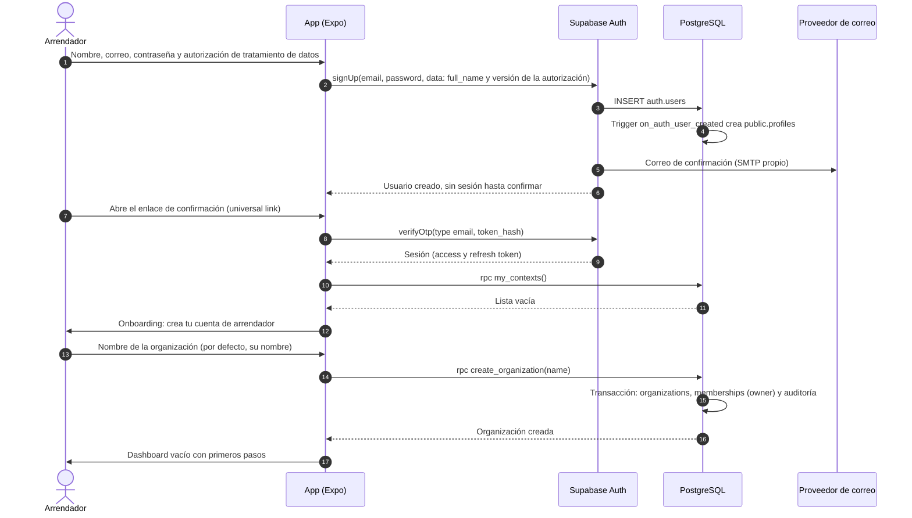

**Por qué la organización no se crea en el trigger de registro:** el mismo registro sirve a inquilinos invitados, que no deben recibir una organización. La creación es una acción explícita (`create_organization`) y deja abierta la Fase 4 (límites por plan en un único punto).

### 7.4. Arranque de la app y resolución de contexto

Un usuario puede tener varios **contextos** (organización + rol). Por ejemplo, ser propietario en su organización e inquilino en otra.

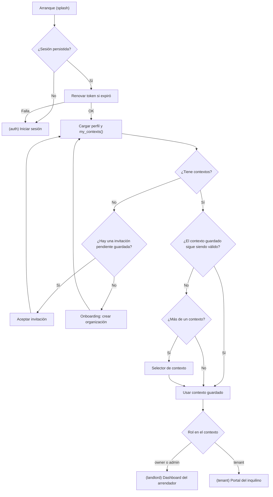

La interfaz decide la navegación según el rol, pero **la autorización real siempre está en la base de datos**: una ruta oculta no protege datos (plan §9).

### 7.5. Vinculación de un inquilino por invitación (flujo 10.3 del plan)

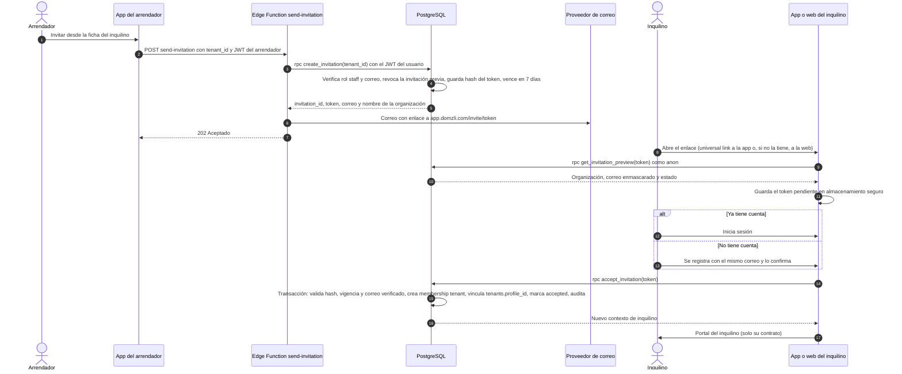

Reglas de la invitación ([ADR-0006](../decisions/0006-invitaciones-propias.md)):

- Token aleatorio de 32 bytes; en la base de datos se guarda **solo su hash** (SHA-256).
- Un solo uso, vigencia de 7 días, revocable, una invitación pendiente por correo y organización.
- Se acepta solo si `auth.users.email` **verificado** coincide con `invitations.email`.
- No se usa `auth.admin.inviteUserByEmail` porque falla si el inquilino ya tiene cuenta (por ejemplo, arrienda a dos propietarios) y crea usuarios en Auth antes de que acepten.

### 7.6. Recuperación de contraseña, cierre de sesión y eliminación de cuenta

- **Recuperación:** `resetPasswordForEmail` → enlace con `token_hash` → `verifyOtp(type: 'recovery')` → `updateUser({ password })`. La respuesta es siempre la misma, exista o no el correo (evita enumerar cuentas).
- **Cierre de sesión:** `signOut({ scope: 'local' })`, `queryClient.clear()`, borrado de la caché persistida y de los stores, y baja del token push (F3).
- **Eliminación de cuenta** (exigida por App Store y Google Play), Edge Function `delete-account`:
  1. Si el usuario es el único `owner` de una organización con contratos activos, se bloquea y se le pide transferir o cerrar la organización.
  2. Se anonimiza `profiles` (nombre "Usuario eliminado"; correo y teléfono nulos) y se revocan sus membresías.
  3. Se desvincula `tenants.profile_id`. La ficha del inquilino es un registro administrativo del arrendador y se conserva.
  4. Se elimina el usuario de `auth.users` con la API de administración.
  5. Los registros financieros y la auditoría se conservan según la política de retención ⚖️ (P-5).

---

## 8. Autorización y seguridad (RLS)

### 8.1. Modelo

- **Multi-organización por fila:** esquema compartido; toda tabla de negocio tiene `organization_id` ([ADR-0003](../decisions/0003-multitenencia-y-rls.md)).
- **Denegar por defecto:** RLS habilitado en **todas** las tablas de `public`. Sin política no hay acceso.
- **Lecturas** con políticas RLS. **Escrituras administrativas** (inmuebles, inquilinos, borradores de contrato) con políticas RLS. **Escrituras financieras y de membresía** solo vía RPC.
- **Helpers de autorización** en el esquema `private` (no expuesto por la API), `SECURITY DEFINER`, `STABLE` y con `search_path` vacío.
- Las membresías **no** viajan en el JWT ([ADR-0011](../decisions/0011-membresias-fuera-del-jwt.md)): un cambio de rol surte efecto de inmediato, sin esperar a que el token expire.

### 8.2. Roles y capacidades

| Capacidad | `owner` | `admin` | `tenant` |
|---|:-:|:-:|:-:|
| Ver y editar datos de la organización | ✅ | Ver | Ver nombre y contacto |
| Gestionar miembros y roles | ✅ (nunca su propio rol) | — | — |
| Gestionar suscripción (F4) | ✅ | Solo con permiso explícito | — |
| Inmuebles: crear, editar, archivar | ✅ | ✅ | Ver el de su contrato |
| Inquilinos: crear, editar, invitar | ✅ | ✅ | Ver su ficha |
| Contratos: crear, activar, renovar, finalizar | ✅ | ✅ | Ver los suyos (no borradores) |
| Cobros: ver, crear manuales, anular | ✅ | ✅ | Ver los suyos |
| Pagos: registrar directo, revisar | ✅ | ✅ | Reportar y ver los suyos |
| Revertir un pago aprobado | ✅ | — | — |
| Ver auditoría | ✅ | ✅ | — |
| Documentos | ✅ | ✅ | Ver los compartidos de su contrato |

El **personal de Domzli** (F4) no es un rol de membresía: se modela en una tabla `platform_admins` y accede por un panel independiente con funciones propias. Nunca se le concede acceso implícito a los datos de una organización.

### 8.3. Funciones auxiliares de autorización

```sql
create schema if not exists private;
revoke all on schema private from public;
grant usage on schema private to authenticated; -- las políticas invocan estos helpers

-- Organizaciones donde el usuario actual es owner o admin activo.
create or replace function private.staff_org_ids()
returns setof uuid
language sql
stable
security definer
set search_path = ''
as $$
  select m.organization_id
  from public.memberships m
  where m.user_id = (select auth.uid())
    and m.status = 'active'
    and m.role in ('owner', 'admin');
$$;

-- Contratos (no borradores) en los que el usuario actual participa como inquilino vinculado.
create or replace function private.tenant_lease_ids()
returns setof uuid
language sql
stable
security definer
set search_path = ''
as $$
  select lt.lease_id
  from public.lease_tenants lt
  join public.tenants t      on t.id = lt.tenant_id
  join public.leases l       on l.id = lt.lease_id
  join public.memberships m  on m.organization_id = t.organization_id
                            and m.user_id = t.profile_id
  where t.profile_id = (select auth.uid())
    and m.role = 'tenant'
    and m.status = 'active'
    and l.status <> 'draft'
    and lt.portal_access;
$$;

-- Análogas: private.owner_org_ids(), private.member_org_ids(), private.tenant_property_ids().
```

Patrón recomendado por Supabase para el rendimiento: `columna in (select private.fn())`. La subconsulta se evalúa **una vez por consulta** y no por fila, y `(select auth.uid())` se almacena en caché. Índices de soporte: `memberships (user_id, status)`, `tenants (profile_id)`, `lease_tenants (tenant_id)`.

### 8.4. Matriz de políticas por tabla

Leyenda: **R** leer · **C** crear · **U** actualizar · **D** borrar · **RPC** escritura solo mediante funciones. Las columnas `owner` y `admin` se agrupan como *staff*.

| Tabla | Staff | Inquilino | Notas |
|---|---|---|---|
| `organizations` | R · U (solo `owner`) | R | Creación vía `create_organization`. Sin `DELETE`. |
| `profiles` | R (miembros de sus organizaciones) · U (propio) | R · U (propio) | `email` se sincroniza desde `auth.users`; no se edita aquí. |
| `memberships` | R | R (propias) | Escritura solo RPC. Trigger impide cambiar el rol propio. |
| `invitations` | R · RPC | — | Vista previa anónima solo vía `get_invitation_preview`. |
| `properties` | R · C · U | R (inmueble de su contrato) | Se archiva (`archived_at`), no se borra. |
| `property_photos` | R · C · U · D | R | |
| `tenants` | R · C · U | R (su ficha) | El inquilino edita sus datos en `profiles`, no aquí. |
| `leases` | R · C · U (solo `status = 'draft'`) · RPC | R | Las transiciones de estado son solo RPC. |
| `lease_tenants` | R · C · U · D (solo en borrador) · RPC | R | |
| `lease_rent_adjustments` | R · RPC | R | |
| `documents` | R · C · U | R (si `visibility = 'shared'` y pertenece a su contrato) | |
| `charges`, `charge_items` | R · RPC | R | Sin escritura directa. |
| `payments`, `payment_allocations` | R · RPC | R · RPC (`report_payment`) | Sin escritura directa. |
| `expenses` (F3) | R · C · U · D | — | |
| `utility_bills` (F3) | R · C · U · D | R (si el responsable es el inquilino) | |
| `notifications` | R · U (propias, solo `read_at`) | R · U (propias, solo `read_at`) | |
| `audit_logs` | R | — | *Append-only*: sin `UPDATE` ni `DELETE` para ningún rol de cliente. |
| `outbox_events` | — | — | Solo procesos internos. |
| `ipc_annual` | R | R | Escritura solo por personal de plataforma. |

Ejemplos:

```sql
alter table public.properties enable row level security;

create policy properties_select on public.properties
  for select to authenticated
  using (
    organization_id in (select private.staff_org_ids())
    or id in (select private.tenant_property_ids())
  );

create policy properties_insert on public.properties
  for insert to authenticated
  with check (organization_id in (select private.staff_org_ids()));

create policy properties_update on public.properties
  for update to authenticated
  using (organization_id in (select private.staff_org_ids()))
  with check (organization_id in (select private.staff_org_ids()));
-- Sin política DELETE: los inmuebles se archivan.

-- Contratos: el staff solo edita borradores; activar o finalizar es exclusivo de las RPC.
create policy leases_update_draft on public.leases
  for update to authenticated
  using (status = 'draft' and organization_id in (select private.staff_org_ids()))
  with check (status = 'draft' and organization_id in (select private.staff_org_ids()));

-- Tablas financieras: solo lectura para clientes.
revoke insert, update, delete on public.charges, public.charge_items,
  public.payments, public.payment_allocations, public.audit_logs,
  public.memberships, public.invitations, public.outbox_events
  from anon, authenticated;
```

Guardas adicionales mediante triggers:

- `organization_id` es **inmutable** después de insertar (impide "mover" filas entre organizaciones donde el usuario es staff).
- `memberships`: nadie puede modificar su propia fila de rol (plan §9.2).
- `audit_logs`: cualquier `UPDATE` o `DELETE` lanza una excepción, incluso con privilegios elevados.

### 8.5. Convenciones de las funciones RPC

1. `SECURITY DEFINER` + `set search_path = ''` + nombres totalmente calificados (`public.charges`).
2. **Primera instrucción:** verificar `auth.uid()` y el rol en la organización del recurso. `SECURITY DEFINER` ignora la RLS, así que la verificación es explícita.
3. Validar entradas (montos > 0, fechas coherentes, pertenencia a la organización).
4. Bloquear filas en **orden determinista** (`FOR UPDATE … ORDER BY id`) para evitar interbloqueos.
5. Escribir la auditoría y el evento de *outbox* **en la misma transacción**.
6. `revoke execute … from public, anon; grant execute … to authenticated;` (PostgreSQL concede `EXECUTE` a `PUBLIC` por defecto).
7. Errores con código de máquina en `message` y `errcode` estándar (`P0001` negocio, `42501` permiso, `22023` parámetro inválido).

Ejemplo de referencia — revisión de un pago:

```sql
create or replace function public.review_payment(
  p_payment_id uuid,
  p_decision   text,            -- 'approve' | 'reject'
  p_reason     text default null
)
returns public.payments
language plpgsql
security definer
set search_path = ''
as $$
declare
  v_payment public.payments;
  v_alloc   record;
  v_applied numeric(14,2) := 0;
begin
  -- 1. Bloquear el pago: serializa revisiones concurrentes.
  select * into v_payment
  from public.payments
  where id = p_payment_id
  for update;

  if not found then
    raise exception 'PAYMENT_NOT_FOUND' using errcode = 'P0002';
  end if;

  -- 2. Autorización explícita.
  if v_payment.organization_id not in (select private.staff_org_ids()) then
    raise exception 'FORBIDDEN' using errcode = '42501';
  end if;

  if v_payment.status <> 'in_review' then
    raise exception 'PAYMENT_NOT_IN_REVIEW' using errcode = 'P0001';
  end if;

  if p_decision = 'reject' then
    if coalesce(btrim(p_reason), '') = '' then
      raise exception 'REJECTION_REASON_REQUIRED' using errcode = 'P0001';
    end if;

    update public.payments
       set status = 'rejected',
           rejection_reason = p_reason,
           reviewed_by = (select auth.uid()),
           reviewed_at = now()
     where id = p_payment_id
    returning * into v_payment;

  elsif p_decision = 'approve' then
    -- 3. Bloquear los cobros afectados en orden determinista.
    for v_alloc in
      select pa.charge_id, pa.allocated_amount,
             c.total_amount, c.paid_amount, c.status
      from public.payment_allocations pa
      join public.charges c on c.id = pa.charge_id
      where pa.payment_id = p_payment_id
      order by c.id
      for update of c
    loop
      if v_alloc.status = 'void' then
        raise exception 'CHARGE_VOID' using errcode = 'P0001';
      end if;
      if v_alloc.allocated_amount > v_alloc.total_amount - v_alloc.paid_amount then
        raise exception 'ALLOCATION_EXCEEDS_BALANCE' using errcode = 'P0001';
      end if;

      update public.charges
         set paid_amount = paid_amount + v_alloc.allocated_amount,
             status = (case
                         when paid_amount + v_alloc.allocated_amount >= total_amount
                           then 'paid'
                         else 'partially_paid'
                       end)::public.charge_status
       where id = v_alloc.charge_id;

      v_applied := v_applied + v_alloc.allocated_amount;
    end loop;

    if v_applied <> v_payment.amount then
      raise exception 'ALLOCATIONS_DO_NOT_MATCH_AMOUNT' using errcode = 'P0001';
    end if;

    update public.payments
       set status = 'approved',
           reviewed_by = (select auth.uid()),
           reviewed_at = now()
     where id = p_payment_id
    returning * into v_payment;

  else
    raise exception 'INVALID_DECISION' using errcode = '22023';
  end if;

  -- 4. Auditoría y notificación en la misma transacción.
  insert into public.audit_logs (organization_id, actor_id, action, entity_type, entity_id, new_data)
  values (v_payment.organization_id, (select auth.uid()), 'payment.' || p_decision,
          'payment', v_payment.id, to_jsonb(v_payment));

  insert into public.outbox_events (organization_id, topic, payload)
  values (v_payment.organization_id, 'payment.reviewed',
          jsonb_build_object('payment_id', v_payment.id, 'decision', p_decision));

  return v_payment;
end;
$$;

revoke execute on function public.review_payment(uuid, text, text) from public, anon;
grant execute on function public.review_payment(uuid, text, text) to authenticated;
```

### 8.6. Storage

| Bucket | Contenido | Ruta | Lectura | Escritura | Límites |
|---|---|---|---|---|---|
| `property-photos` | Fotos de inmuebles | `{org_id}/properties/{property_id}/{uuid}.jpg` | Staff · inquilino del inmueble | Staff | 5 MB · `image/jpeg`, `image/png`, `image/webp` |
| `lease-documents` | Contratos, otrosíes, actas de entrega | `{org_id}/leases/{lease_id}/{uuid}.pdf` | Staff · inquilino si el documento es `shared` | Staff | 15 MB · `application/pdf`, imágenes |
| `payment-receipts` | Comprobantes de pago | `{org_id}/leases/{lease_id}/payments/{uuid}.{ext}` | Staff · inquilino del contrato | Staff · inquilino del contrato (solo crear) | 10 MB · `application/pdf`, imágenes |
| `expense-receipts` (F3) | Soportes de gastos | `{org_id}/properties/{property_id}/expenses/{uuid}.{ext}` | Staff | Staff | 10 MB |

- **Todos los buckets son privados** ([ADR-0012](../decisions/0012-storage-privado.md)). El acceso es con URLs firmadas: 5 minutos para comprobantes y contratos, 1 hora para fotos.
- El primer segmento de la ruta es el `organization_id`. Las políticas lo comparan **como texto**, de modo que una ruta malformada no provoca errores de conversión:

```sql
create policy receipts_select on storage.objects
  for select to authenticated
  using (
    bucket_id = 'payment-receipts'
    and (
      (storage.foldername(name))[1] in (select t.id::text from private.staff_org_ids() as t(id))
      or (storage.foldername(name))[3] in (select t.id::text from private.tenant_lease_ids() as t(id))
    )
  );

create policy receipts_insert on storage.objects
  for insert to authenticated
  with check (
    bucket_id = 'payment-receipts'
    and (storage.foldername(name))[2] = 'leases'
    and (storage.foldername(name))[4] = 'payments'
    and (
      (storage.foldername(name))[1] in (select t.id::text from private.staff_org_ids() as t(id))
      or (storage.foldername(name))[3] in (select t.id::text from private.tenant_lease_ids() as t(id))
    )
  );
-- Sin UPDATE ni DELETE: un comprobante es inmutable una vez cargado.
```

- `report_payment` verifica que `receipt_path` exista en `storage.objects` y que corresponda al mismo contrato, para que nadie adjunte un archivo ajeno.
- El cliente comprime las imágenes antes de subirlas (`expo-image-manipulator`, JPEG de 2.000 px como máximo) y convierte HEIC a JPEG.
- Los archivos huérfanos (subidos sin pago asociado) se limpian con un proceso semanal (F2).

### 8.7. Protección de datos personales (Ley 1581 de 2012) ⚖️

| Requisito | Implementación |
|---|---|
| Autorización del titular | Casilla obligatoria en el registro; se guardan versión y fecha (`profiles.data_consent_version`, `data_consent_at`). |
| Política de tratamiento | Publicada en la web y enlazada en el registro y en Cuenta. |
| Roles | Para los datos de sus inquilinos, el arrendador es **responsable** y Domzli es **encargado** del tratamiento. Debe reflejarse en los términos de servicio. |
| Derechos del titular (consulta, actualización, rectificación, supresión) | Edición del perfil; eliminación de cuenta (§7.6); canal de soporte para solicitudes. |
| Minimización | No se almacenan copias de documentos de identidad salvo necesidad justificada. Los números de documento se muestran enmascarados. |
| Transferencia internacional | Región del proyecto de Supabase a validar con concepto jurídico (los candidatos por latencia son `us-east-1` y `sa-east-1`). |
| Registro Nacional de Bases de Datos | Validar si Domzli está obligada a inscribirse ante la SIC. |

### 8.8. Gestión de secretos

- En el cliente solo existen la URL del proyecto y la **clave pública** (`EXPO_PUBLIC_*`). Todo `EXPO_PUBLIC_*` se considera público.
- La clave secreta (`service_role`), las llaves de la pasarela y las de correo viven en los **secretos de Edge Functions** y en los secretos del CI. Nunca en el repositorio.
- Rotación documentada. `.env.example` lista nombres sin valores.

### 8.9. Modelo de amenazas resumido

| Amenaza | Mitigación |
|---|---|
| Acceso a datos ajenos manipulando IDs en la API | RLS en todas las tablas, FK compuestas por organización, pruebas pgTAP negativas. |
| Escalada de privilegios (autoasignarse `owner`) | `memberships` sin escritura directa; RPC con verificación; trigger contra el cambio del rol propio. |
| Inquilino que marca su pago como aprobado | Estado definido solo por RPC; sin `UPDATE` sobre `payments`. |
| Doble aplicación de un pago | `FOR UPDATE` sobre el pago; la transición `in_review → approved` solo ocurre una vez. |
| Cobros duplicados | Índice único `(lease_id, period_start)` para cobros programados, `ON CONFLICT DO NOTHING` y *advisory lock*. |
| Acceso a comprobantes adivinando URLs | Buckets privados, rutas con UUID, URLs firmadas de vida corta. |
| Robo de sesión en el dispositivo | Sesión cifrada con clave en Keychain/Keystore; *refresh token* rotativo. |
| XSS en web | Sin HTML dinámico, CSP estricta, escape por defecto de React. |
| Filtración del token de invitación | Hash en la base de datos, un solo uso, vigencia corta, ligado al correo verificado. |
| Enumeración de correos | Respuestas idénticas en registro y recuperación; CAPTCHA. |
| Archivos maliciosos | Tipos MIME y tamaño restringidos por bucket; nunca se ejecutan ni se renderizan como HTML. |
| Webhooks falsificados (F3) | Verificación de firma, idempotencia por ID de evento, consulta de confirmación a la API de la pasarela. |

---

## 9. Modelo de datos

### 9.1. Convenciones

| Aspecto | Convención |
|---|---|
| Claves primarias | `uuid` con `gen_random_uuid()`, salvo `audit_logs` y `outbox_events` (`bigint` identidad). |
| Nombres | `snake_case`, tablas en plural, en inglés. |
| Tiempo | `timestamptz` para instantes; `date` para fechas de negocio (vencimientos, períodos). |
| Auditoría de fila | `created_at`, `updated_at` (trigger), `created_by` cuando aplica. |
| Montos | `numeric(14,2)` con `CHECK (amount >= 0)` o `> 0`. Moneda en `organizations.currency`. |
| Enumeraciones | Tipos `enum` de PostgreSQL para estados estables. Añadir valores es seguro; eliminarlos no. |
| Borrado | Nada financiero se borra. Inmuebles e inquilinos se archivan (`archived_at`). Los contratos terminan (`terminated`). Los cobros se anulan (`void`). |
| Pertenencia | Toda tabla de negocio tiene `organization_id` (también las hijas, para que la RLS no requiera joins). |

### 9.2. Diagrama entidad-relación: identidad y administración

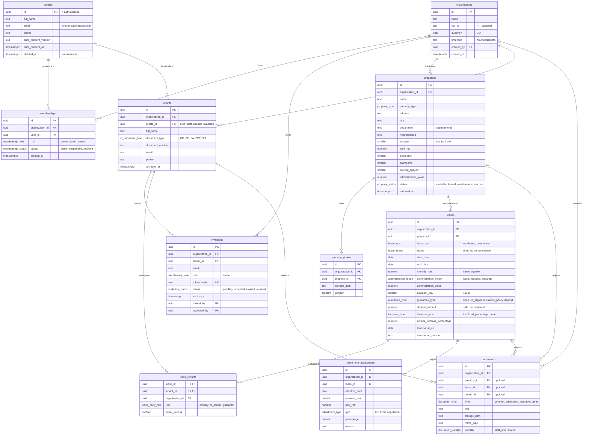

### 9.3. Diagrama entidad-relación: finanzas y transversales

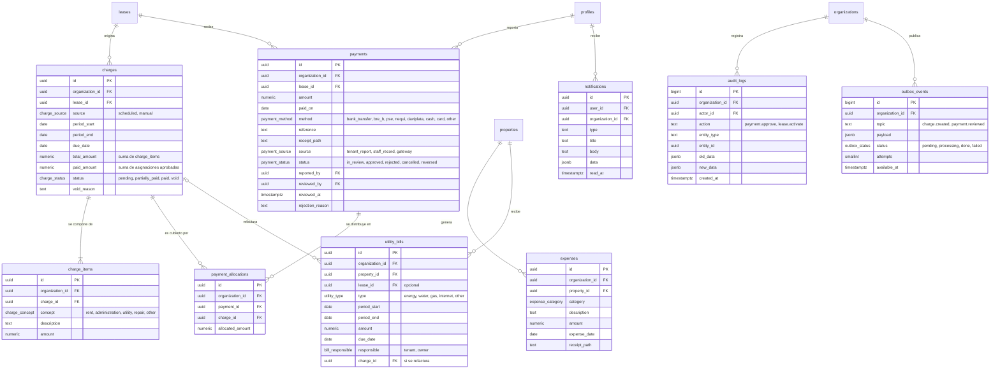

Tablas fuera de los diagramas: `ipc_annual` (año, variación del IPC, fuente; global y de solo lectura) y `platform_admins` (F4).

### 9.4. Reglas de integridad (plan §8.3) y su mecanismo

| Regla del plan | Mecanismo en la base de datos |
|---|---|
| Un inmueble no puede tener dos contratos activos | `create unique index leases_one_active_per_property on leases (property_id) where status = 'active';` |
| Contratos, inmuebles e inquilinos de la misma organización | `unique (organization_id, id)` en las tablas padre y **FK compuestas**, por ejemplo `foreign key (organization_id, property_id) references properties (organization_id, id)`. |
| Los cobros pertenecen a un contrato | `charges.lease_id not null` + FK compuesta. |
| Sin cobros equivalentes para el mismo período | `create unique index charges_one_scheduled_per_period on charges (lease_id, period_start) where source = 'scheduled';` |
| Los pagos aprobados se reflejan en sus asignaciones | `review_payment` exige `sum(allocated_amount) = amount` y actualiza `paid_amount` en la misma transacción. Prueba de reconciliación: `paid_amount = sum(asignaciones de pagos aprobados)`. |
| Los pagos rechazados no alteran saldos | Solo la rama `approve` modifica `charges`. |
| La finalización no elimina historial | Sin `DELETE` sobre contratos activos o terminados; `terminate_lease` cambia el estado. |
| Conservación de documentos | Sin `DELETE` en buckets de contratos y comprobantes; archivado lógico. ⚖️ P-5 |
| Saldo coherente | `CHECK (paid_amount >= 0 and paid_amount <= total_amount)` en `charges`. |
| Fechas coherentes | `CHECK (end_date > start_date)`, `CHECK (payment_day between 1 and 31)`, `CHECK (period_end >= period_start)`. |
| Un solo titular principal | `create unique index on lease_tenants (lease_id) where role = 'primary';` |
| Un contrato activo tiene titular | `activate_lease` verifica que exista exactamente un `primary`. |

### 9.5. Estados

**Contrato.** "Por vencer" (≤ 60 días para `end_date`) y "En prórroga" (`end_date` pasada y sigue activo) son estados **derivados** que se calculan en vistas; no se almacenan.

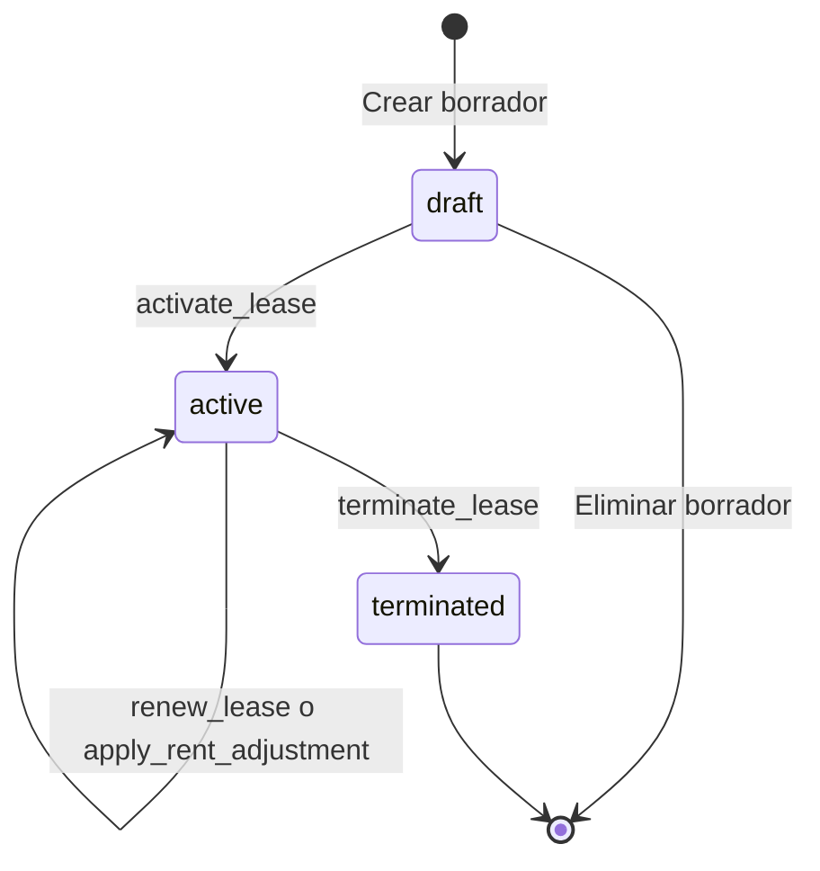

**Cobro.** "Vencido" se deriva: `status in ('pending', 'partially_paid') and due_date < hoy (America/Bogota)`.

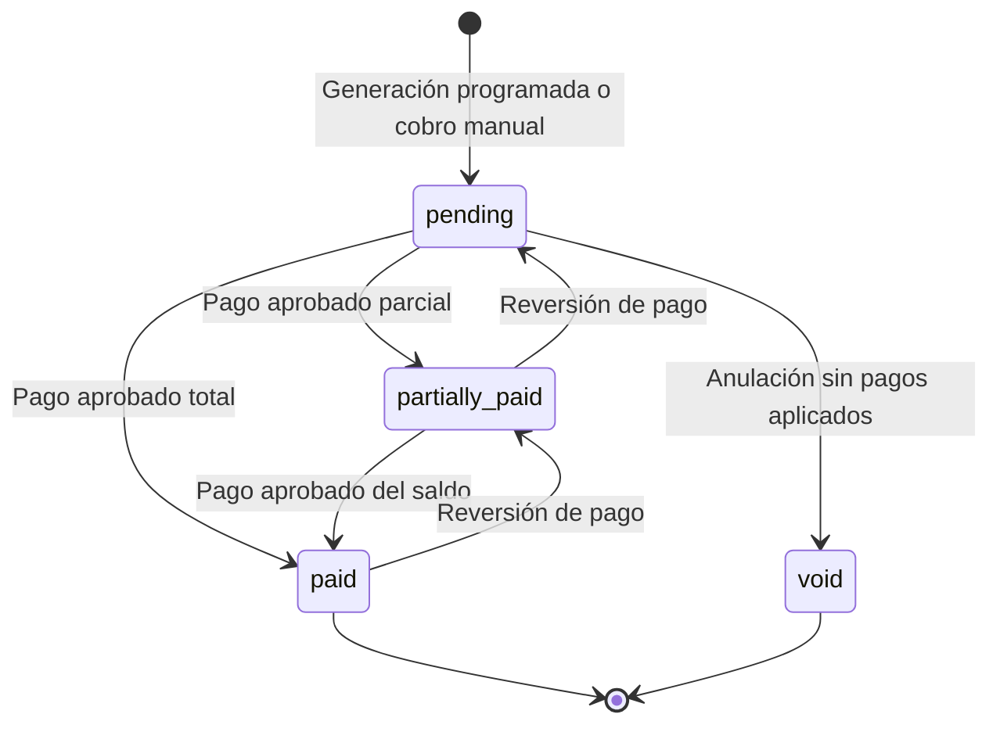

**Pago.**

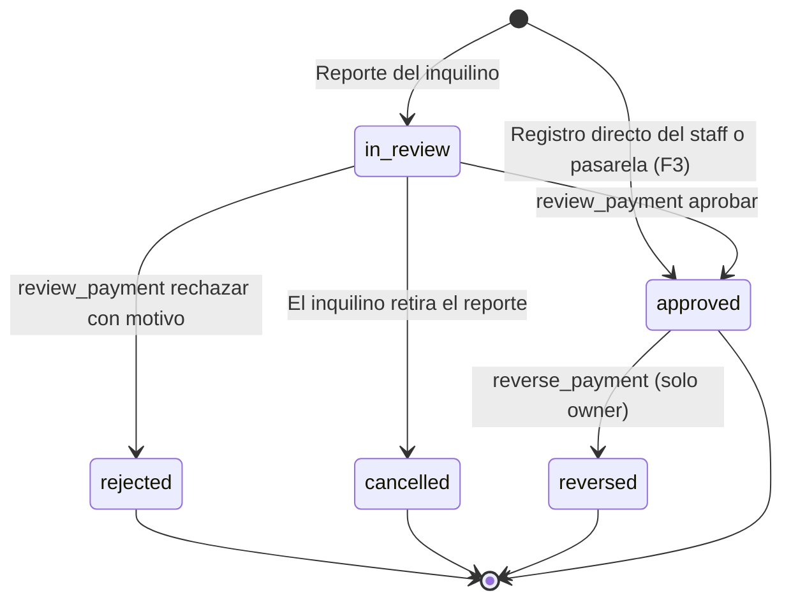

**Invitación:** `pending → accepted | expired | revoked`. `expired` lo asigna un proceso horario.

### 9.6. Vistas de lectura

Todas con `security_invoker = true`, para que apliquen la RLS de quien consulta:

| Vista | Propósito |
|---|---|
| `v_charge_balances` | Cobro con `balance`, `is_overdue` y `days_overdue`. |
| `v_lease_overview` | Contrato con inmueble, titular, `days_to_end`, `is_expiring_soon`, `is_in_extension` y saldo pendiente. |
| `v_property_overview` | Inmueble con contrato activo, inquilino titular, canon vigente y foto de portada. |
| `v_tenant_statement` | Estado de cuenta del inquilino: cobros, pagos y saldo por contrato. |

### 9.7. Índices clave

`memberships (user_id, status)` · `memberships (organization_id)` · `tenants (profile_id)` · `lease_tenants (tenant_id)` · `leases (organization_id, status)` · `charges (organization_id, status, due_date)` · `charges (lease_id, due_date)` · `payments (organization_id, status, created_at desc)` · `payments (lease_id)` · `payment_allocations (charge_id)` · `audit_logs (organization_id, entity_type, entity_id, created_at desc)` · `outbox_events (status, available_at)`. Además, todas las FK tienen índice.

---

## 10. Flujos de negocio críticos

### 10.1. Creación y activación de un contrato (flujo 10.4 del plan)

1. El asistente de la app crea un **borrador** (`leases.status = 'draft'`) con inserciones directas protegidas por RLS: inmueble, participantes, condiciones y fechas.
2. El documento firmado se sube a `lease-documents` y se registra en `documents` (`kind = 'contract'`).
3. `activate_lease(lease_id)` en una transacción:
   - Bloquea el inmueble (`FOR UPDATE`) y verifica que esté disponible y no archivado.
   - Verifica que haya exactamente un titular `primary` y que todos los participantes sean de la misma organización.
   - Valida las reglas de P-12 (depósito solo en uso comercial) y P-2 (configuración de reajuste).
   - Cambia el contrato a `active` (el índice único impide un segundo contrato activo) y el inmueble a `leased`.
   - Registra la auditoría y emite `lease.activated` al *outbox*.
4. Si el titular no tiene cuenta vinculada, la app ofrece **invitarlo** (§7.5).
5. En F2, la activación invoca `generate_charges_for_lease` para crear los cobros vencidos o próximos.

### 10.2. Generación de cobros (flujo 10.5 del plan)

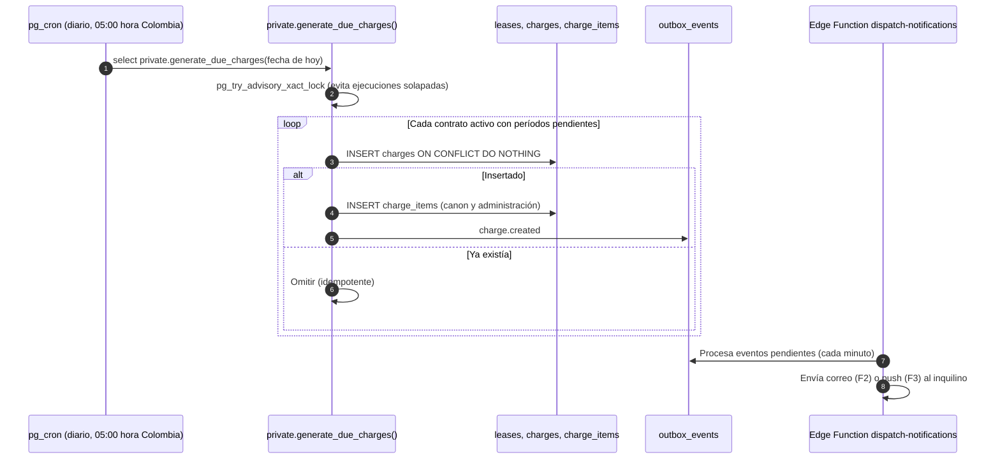

Algoritmo (períodos en mes calendario, ver P-11):

```text
hoy := (now() at time zone 'America/Bogota')::date
para cada contrato con status = 'active':
  para cada período p desde el último generado + 1 (o desde start_date):
    si p.period_start - lead_days > hoy: terminar        -- lead_days = 5 por defecto
    canon := canon vigente en p.period_start             -- lease_rent_adjustments
    si p es el primer o último período parcial: prorratear por días y redondear al peso
    due_date := min(payment_day, último día del mes de p)
    insert into charges (...) values (...)
      on conflict (lease_id, period_start) where source = 'scheduled' do nothing
    si se insertó:
      insert charge_items: rent (+ administration si administration_mode = 'separate')
      total_amount := suma de ítems
      insert outbox_events ('charge.created')
```

- **Idempotente:** volver a ejecutarlo nunca duplica, gracias al índice único. Si el cron deja de correr varios días, la siguiente ejecución **se pone al día**.
- **Programación:** `pg_cron` trabaja en UTC; las 05:00 de Colombia son `0 10 * * *`.
- **Contratos en prórroga:** mientras el contrato siga `active`, se siguen generando cobros aunque `end_date` haya pasado (prórroga automática, ⚖️ P-13).
- **Nunca desde el dispositivo** (plan §8.3).

### 10.3. Reporte y revisión de pagos (flujo 10.6 del plan)

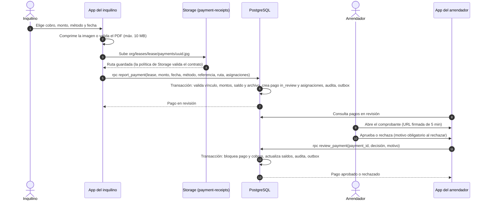

Reglas:

- **Asignación:** el inquilino paga contra uno o varios cobros. Si no elige, se asigna por antigüedad de vencimiento (FIFO). El monto no puede superar el saldo pendiente total (sin saldo a favor en el MVP, P-4).
- Si dos reportes pendientes compiten por el mismo saldo, el segundo en aprobarse falla con `ALLOCATION_EXCEEDS_BALANCE`. El arrendador lo rechaza o lo reasigna.
- El **registro directo** del arrendador (por ejemplo, pago en efectivo) usa la misma RPC con `source = 'staff_record'`; queda `approved` de inmediato y se audita igual.
- **Aprobar un comprobante no equivale a una confirmación bancaria** (plan §10.6). La interfaz lo dice explícitamente.

### 10.4. Finalización de un contrato

`terminate_lease(lease_id, end_date, reason)`: verifica el saldo pendiente y advierte si existe (no lo bloquea), anula los cobros programados posteriores a la fecha de terminación que no tengan pagos, cambia el contrato a `terminated` y el inmueble a `available`, conserva el acceso de solo lectura del inquilino a su historial, audita y emite `lease.terminated`.

---

## 11. Procesos en segundo plano e integraciones

### 11.1. Tareas programadas (`pg_cron`)

| Tarea | Programación (UTC) | Acción | Fase |
|---|---|---|---|
| `generate-due-charges` | `0 10 * * *` (05:00 COT) | `private.generate_due_charges(hoy)` | F2 |
| `expire-invitations` | `0 * * * *` | Pasa a `expired` las invitaciones vencidas | F1 |
| `dispatch-outbox` | `* * * * *` | `pg_net` llama a `dispatch-notifications` si hay eventos pendientes | F2 |
| `cleanup-orphan-receipts` | `0 8 * * 0` | Elimina comprobantes sin pago asociado con más de 7 días | F2 |
| `lease-expiry-reminders` | `0 13 * * *` | Avisos a 90, 60 y 30 días del fin del contrato | F3 |
| `payment-due-reminders` | `0 13 * * *` | Recordatorios antes y después del vencimiento | F3 |

Los fallos se consultan en `cron.job_run_details` y generan alertas (§13).

### 11.2. Patrón *outbox* para notificaciones

Las RPC escriben en `outbox_events` **dentro de la misma transacción** que el cambio de negocio ([ADR-0014](../decisions/0014-outbox-de-notificaciones.md)). `dispatch-notifications` toma lotes con `FOR UPDATE SKIP LOCKED`, envía con reintentos y retroceso exponencial (máximo 5 intentos) y marca `done` o `failed`. Así, una notificación nunca se pierde si el proveedor falla, y nunca se envía la de una transacción revertida.

### 11.3. Correo y push

- **Correo:** un proveedor transaccional (P-10) para Auth (por SMTP) y para negocio (por API desde Edge Functions). Dominio propio con SPF, DKIM y DMARC.
- **Push (F3):** Expo Push Service; tabla `push_tokens (user_id, token, platform, last_seen_at)`. Los tokens inválidos se eliminan con los recibos de Expo.
- **Canales futuros:** WhatsApp Business API es un candidato natural en Colombia para recordatorios de pago (fuera del alcance actual).

### 11.4. Pasarela de pagos (F3)

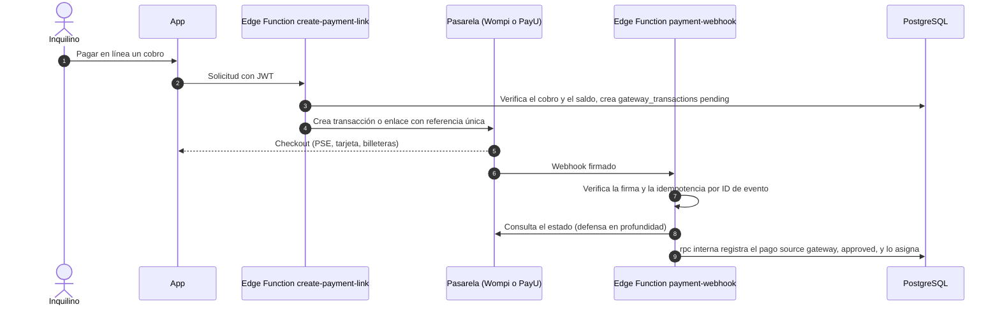

**Consideración regulatoria ⚖️:** se recomienda que **cada organización conecte su propia cuenta de comercio** en la pasarela, de modo que el dinero vaya directamente al arrendador. Si Domzli recauda fondos de terceros, podría quedar sujeta a obligaciones adicionales (agregador o recaudador de pagos). Ver P-7.

### 11.5. Facturación electrónica (F3) ⚖️

Se integrará mediante un **proveedor tecnológico autorizado por la DIAN**, desde una Edge Function y con el *outbox*. La obligación de facturar y el tratamiento del IVA difieren entre arriendos de vivienda y comerciales y según el régimen del arrendador. Se debe validar con un contador antes de diseñar el módulo (P-6).

---

## 12. Entornos, CI/CD y despliegue

### 12.1. Entornos

| Entorno | Base de datos | App móvil | Web | Datos |
|---|---|---|---|---|
| **Local** | `supabase start` (Docker) | Expo Dev Client | `expo start --web` | `seed.sql` sintético |
| **Staging** | Proyecto Supabase independiente | EAS Build perfil `preview`, canal EAS Update `preview` | Despliegue de vista previa | Sintéticos; nunca datos reales |
| **Producción** | Proyecto Supabase independiente (plan Pro, PITR al tener datos reales) | EAS Build perfil `production`, canal `production` | Dominio principal | Reales |

Variables del cliente: `EXPO_PUBLIC_SUPABASE_URL`, `EXPO_PUBLIC_SUPABASE_PUBLISHABLE_KEY`, `EXPO_PUBLIC_APP_ENV`, `EXPO_PUBLIC_SENTRY_DSN`. **Web:** exportación estática (`expo export -p web`) servida desde EAS Hosting o un CDN equivalente, con `apple-app-site-association` y `assetlinks.json` en el mismo dominio para los enlaces universales.

### 12.2. Pipeline

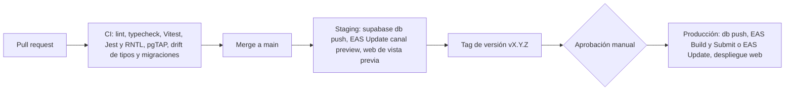

Verificaciones del CI en cada PR:

1. `eslint` (incluye reglas de capas y del Design System) y `tsc --noEmit`.
2. Vitest (dominio y utilidades) y Jest + RNTL (componentes).
3. `supabase start` + `supabase test db` (pgTAP: RLS, RPC, restricciones).
4. `supabase db lint` y comprobación de *drift* entre migraciones y esquema.
5. `supabase gen types` + `git diff --exit-code` sobre `src/types/database.ts`.

### 12.3. Compatibilidad entre versiones de la app y de la base de datos

Las apps móviles no se actualizan todas a la vez: **la base de datos debe ser compatible con la versión N−1 de la app**.

- **Migraciones solo hacia adelante** con el patrón *expand/contract*: primero se añade (columna nueva o RPC `v2`), después se migra el cliente y por último se elimina lo antiguo, en una versión posterior.
- Las firmas de las RPC no cambian de forma incompatible; se crean versiones nuevas.
- Tabla `app_config` con `min_supported_version` por plataforma: la app la consulta al arrancar y muestra una pantalla de actualización obligatoria si es necesario.
- **EAS Update** con `runtimeVersion` basada en *fingerprint*, para no enviar por OTA código incompatible con el binario nativo instalado.

---

## 13. Observabilidad, respaldo y operación

| Área | Herramienta | Qué se mide o alerta |
|---|---|---|
| Errores del cliente | Sentry (`@sentry/react-native`, web incluida) con *source maps* subidos desde EAS | Fallos, *release health*, rendimiento de pantallas. Datos personales filtrados (`beforeSend`). |
| Base de datos | Supabase: logs, `pg_stat_statements`, *advisors* de seguridad y rendimiento | Consultas lentas; tablas sin RLS; índices faltantes (revisión en cada release). |
| Procesos programados | `cron.job_run_details` + función de verificación diaria | Alerta si `generate-due-charges` no terminó con éxito en 24 h. |
| *Outbox* | Consulta de eventos `pending` antiguos | Alerta si hay eventos de más de 15 minutos sin procesar o en `failed`. |
| Edge Functions | Logs de Supabase | Tasa de errores por función. |
| Negocio | `audit_logs` y vistas SQL de métricas (plan §13) | Base del panel interno (F4). |
| Analítica de producto | Por definir (por ejemplo, PostHog), con consentimiento | Embudos de activación (registro → primer inmueble → primer contrato → primer pago). |

**Respaldo y recuperación:**

- Copias diarias de Supabase (plan Pro) y **PITR** al operar con datos reales: RPO ≤ 5 min, RTO ≤ 4 h.
- **Los respaldos de la base de datos no restauran los archivos de Storage.** Se programa (F2) una copia periódica de los buckets a un almacenamiento externo.
- Simulacro de restauración en staging cada trimestre.

---

## 14. Estrategia de pruebas

| Nivel | Herramienta | Alcance | Prioridad |
|---|---|---|---|
| **Base de datos** | pgTAP (`supabase test db`) | Cada política RLS con casos positivos y **negativos** por rol (owner, admin, tenant, usuario de otra organización, anónimo); cada RPC (caminos felices, errores, concurrencia básica); restricciones únicas; invariantes de saldos. | **Máxima.** Es la frontera de seguridad. |
| **Dominio** | Vitest | Dinero, fechas y períodos, prorrateo, estados derivados, esquemas Zod. | Alta |
| **Componentes** | Jest (`jest-expo`) + React Native Testing Library | Variantes, estados y roles de accesibilidad de los componentes del Design System y de dominio. | Media |
| **Extremo a extremo** | Maestro (móvil) y Playwright (web) | Registro → inmueble → contrato → invitación → aceptación (F1). Cobro → reporte → aprobación (F2). | Media |
| **Manual** | Lista de verificación por release | Lectores de pantalla, tamaños de fuente grandes, modo sin conexión. | — |

> **Vitest y React Native:** React Native Testing Library está pensada para Jest, y el *preset* `jest-expo` resuelve las transformaciones de React Native. Se propone **Vitest para código TypeScript puro** y **Jest para componentes** ([ADR-0013](../decisions/0013-estrategia-de-pruebas.md)). Es un ajuste respecto al plan (§5.1).

Metas: 100 % de las ramas de las RPC financieras cubiertas en pgTAP, todas las tablas con pruebas RLS negativas y ≥ 90 % de cobertura en `features/*/domain`.

---

## 15. Decisiones técnicas (índice de ADR)

| ADR | Decisión | Estado |
|---|---|---|
| [0001](../decisions/0001-cliente-unico-expo.md) | Cliente único multiplataforma con Expo, Expo Router y React Native Web | Aceptada (plan) |
| [0002](../decisions/0002-supabase-como-backend.md) | Supabase como backend gestionado, sin servidor de aplicaciones propio | Aceptada (plan) |
| [0003](../decisions/0003-multitenencia-y-rls.md) | Multi-organización por fila con `organization_id` y autorización con RLS | Aceptada (plan) |
| [0004](../decisions/0004-escrituras-financieras-via-rpc.md) | Escrituras financieras y de membresía solo mediante RPC transaccionales | Propuesta |
| [0005](../decisions/0005-logica-programada-en-postgres.md) | Lógica programada en PostgreSQL (`pg_cron`); Edge Functions solo para integraciones | Propuesta |
| [0006](../decisions/0006-invitaciones-propias.md) | Invitaciones con tabla propia y token de un solo uso ligado al correo | Propuesta |
| [0007](../decisions/0007-participantes-del-contrato.md) | Participantes del contrato mediante `lease_tenants` | Propuesta |
| [0008](../decisions/0008-representacion-de-montos.md) | Montos `numeric(14,2)`; cálculo autoritativo en la base de datos | Propuesta |
| [0009](../decisions/0009-design-system-propio.md) | Design System propio sobre NativeWind con variantes `cva` | Propuesta |
| [0010](../decisions/0010-estado-servidor-y-offline.md) | TanStack Query como estado del servidor; sin mutaciones financieras sin conexión | Propuesta |
| [0011](../decisions/0011-membresias-fuera-del-jwt.md) | Membresías fuera del JWT; autorización por funciones auxiliares | Propuesta |
| [0012](../decisions/0012-storage-privado.md) | Storage privado con rutas por organización y URLs firmadas | Propuesta |
| [0013](../decisions/0013-estrategia-de-pruebas.md) | pgTAP para RLS y RPC, Vitest para lógica pura, Jest + RNTL para componentes | Propuesta |
| [0014](../decisions/0014-outbox-de-notificaciones.md) | Notificaciones mediante *outbox* transaccional | Propuesta |
| [0015](../decisions/0015-direccion-visual-billetera.md) | Dirección visual "Billetera digital" para las pantallas de inicio | Aceptada |

---

## 16. Decisiones de negocio pendientes: recomendación técnica

Las decisiones 1 a 10 vienen del plan (§15). Las 11 a 14 surgen del diseño técnico. La columna **Bloquea** indica qué no puede construirse sin cerrarla.

| # | Decisión | Recomendación técnica | Bloquea | ⚖️ |
|---|---|---|---|---|
| P-1 | Administración incluida en el canon o cobrada aparte | Configurable por contrato con `administration_mode` (`none`, `included`, `separate`). Valor por defecto: `separate`, que genera un ítem `administration` en cada cobro. | Generación de cobros (F2) | No |
| P-2 | Incrementos contractuales | `increase_type` (`ipc`, `fixed_percentage`, `none`) + `lease_use`. **Vivienda urbana:** el sistema **propone** el reajuste tras 12 meses con tope en el IPC del año calendario anterior (Ley 820 de 2003, art. 20) y el arrendador lo **confirma** (`apply_rent_adjustment`). **Comercial:** según el contrato. Requiere la tabla `ipc_annual`. | Reajustes (F2) | Sí |
| P-3 | Uno o varios inquilinos por contrato | Modelo N:M desde el inicio (`lease_tenants`, con rol `primary`, `co_tenant` o `guarantor` para el codeudor). La UI del MVP gestiona **un titular** y, opcionalmente, codeudores sin acceso al portal. | Contratos (F1) | No |
| P-4 | Abonos | Permitir pagos parciales. Asignación explícita al cobro elegido o FIFO por vencimiento. Sin saldo a favor en el MVP (monto ≤ saldo pendiente total). | Pagos (F2) | No |
| P-5 | Conservación de documentos | Buckets privados, sin borrado físico de contratos ni soportes. Retención mínima sugerida de 10 años para soportes contables. | Documentos (F1) | Sí |
| P-6 | Facturación electrónica | No implementar hasta validar con un contador la obligación de facturar y el IVA por tipo de arriendo. Diseño preparado: proveedor tecnológico + Edge Function + *outbox*. | F3 | Sí |
| P-7 | Wompi o PayU | Comparar: medios disponibles (PSE, tarjetas, Nequi, Bre-B), costos, tiempos de dispersión, firma de webhooks, entorno de pruebas, conciliación y **posibilidad de que cada arrendador use su propia cuenta de comercio**. | F3 | Sí |
| P-8 | Cobertura de Expo Web | *Spike* en las semanas 1 y 2 de F1 (§6.8). Criterio: si un componente no es viable, implementación `.web.tsx` dedicada; si fallan varios críticos, reevaluar ADR-0001. | F1 | No |
| P-9 | Monetización | No implementar. Los límites de plan se verificarán en un único punto (`private.assert_within_plan_limits()`) invocado desde las RPC de creación cuando exista F4. | F4 | No |
| P-10 | Proveedores de correo y push | Correo: Resend, Postmark o Amazon SES (criterios: entregabilidad en Gmail y Outlook, precio, plantillas, soporte SMTP). Push: Expo Push Service. Recomendación inicial: **Resend + Expo Push**. | F1 (correo) · F3 (push) | No |
| P-11 | Definición del período de cobro *(nueva)* | **Mes calendario** con `payment_day` (si el mes es más corto, el último día). Primer y último período **prorrateados por días** y redondeados al peso. Alternativa: períodos por aniversario del contrato. | Generación de cobros (F2) | No |
| P-12 | Depósito en dinero *(nueva)* | La Ley 820 de 2003 (art. 16) prohíbe exigir depósitos en dinero en vivienda urbana. `deposit_amount` solo se habilita para `lease_use = 'commercial'`; en vivienda se registra `guarantee_type` (codeudor, póliza). | Contratos (F1) | Sí |
| P-13 | Prórroga automática *(nueva)* | Un contrato vencido sin terminación sigue `active` (en prórroga) y sigue generando cobros. Avisos a 90, 60 y 30 días considerando los plazos legales de preaviso. | Contratos (F1) · Recordatorios (F3) | Sí |
| P-14 | Intereses de mora *(nueva)* | No calcularlos en el MVP: solo marcar "vencido". Los intereses tienen topes legales (tasa de usura) que requieren reglas específicas. | F2 | Sí |

### 16.1. Decisiones cerradas por el propietario del producto (17 nov 2026)

| # | Decisión | Cómo queda implementado |
|---|---|---|
| P-3 | **Un inquilino por contrato.** | `lease_tenants` conserva la relación (ADR-0007), con un índice único por contrato (`lease_tenants_one_per_lease`). `activate_lease` exige exactamente un titular. Para admitir cotitulares o codeudores bastará con quitar ese índice. |
| P-5 | **Documentos en Supabase Storage.** | Buckets privados `property-photos` y `lease-documents`, con políticas por ruta y sin borrado de contratos. |
| P-8 | **Web: todavía no.** | El *spike* de Expo Web queda aplazado. La Fase 1 se construye y verifica para móvil; la exportación web solo se usa como comprobación de compilación. |
| P-10 | **Proveedor de correo: sin definir.** | `create_invitation` devuelve el enlace para compartirlo manualmente (WhatsApp, copiar). La Edge Function `send-invitation` queda pendiente del proveedor. En desarrollo, Auth usa el SMTP integrado de Supabase. |
| P-12 | **Sin depósitos**, por sus consecuencias legales. | Se eliminó `deposit_amount` del modelo. `guarantee_type` solo admite `none`, `co_signer` e `insurance_policy`. |
| P-13 | **La prórroga debe poder realizarse.** | Un contrato vencido sigue `active` (en prórroga, `v_lease_overview.is_in_extension`) hasta que se termina o se renueva con `renew_lease`. |

### 16.2. Decisiones aplicadas en la Fase 2 según la recomendación técnica

Estas decisiones no las cerró el propietario del producto: se aplicó la recomendación de §16 y se pueden cambiar en una migración nueva si se decide otra cosa.

| # | Cómo queda implementado | Dónde |
|---|---|---|
| P-1 | `administration_mode = 'separate'` agrega un ítem `administration` a cada cobro programado; `included` y `none` no. | `private.generate_charges_for_lease` |
| P-2 | **Vivienda:** `apply_rent_adjustment` exige 12 meses sin reajuste y un aumento que no supere el IPC del año anterior (`ipc_annual`, con 2022–2024 precargados). **Comercial:** libre. Las rebajas siempre se permiten. No se reajusta un período que ya tiene cobro. El sistema no aplica reajustes solo: los confirma el arrendador. ⚖️ | `apply_rent_adjustment`, `private.rent_at` |
| P-4 | Abonos permitidos. Un pago se aplica a los cobros elegidos o, si no se elige ninguno, del vencimiento más antiguo al más reciente. Sin saldo a favor: el monto no puede superar lo pendiente, descontando lo que ya está comprometido por pagos en revisión. | `report_payment`, `private.pending_allocated` |
| P-11 | **Mes calendario.** El primer período se prorratea por días y se redondea al peso. El vencimiento es el `payment_day` del mes (el último día si el mes es más corto), nunca antes del inicio del período. Los cobros se generan 5 días antes del inicio del período, una sola vez por período (índice único `charges_one_scheduled_per_period`). | `private.generate_charges_for_lease` |
| P-14 | Sin intereses de mora: un cobro abierto con vencimiento pasado se marca "vencido" (`v_charge_balances.is_overdue`). ⚖️ | `v_charge_balances` |

Además:

- **`leases.billing_start_date`:** para un contrato que ya venía corriendo antes de llegar a Domzli, los cobros empiezan en esa fecha y no se generan los meses anteriores. El asistente lo propone (primer día del mes actual) cuando la fecha de inicio es anterior.
- **Pagos del inquilino:** quedan `in_review` y exigen comprobante (bucket privado `payment-receipts`). El arrendador los aprueba o los rechaza con motivo; el inquilino puede cancelar los que siguen en revisión. Los pagos que registra el arrendador se aprueban de inmediato. Solo el propietario de la organización puede revertir un pago aprobado.
- **Terminar un contrato** anula los cobros posteriores a la fecha de terminación que no tengan pagos.
- **Tarea programada:** la migración programa `generate-due-charges` (diaria, 05:00 de Colombia) y `expire-invitations` (cada hora) si `pg_cron` está disponible. Si no lo está, la app pone los cobros al día al abrir Inicio o Finanzas (`generate_due_charges`, idempotente).

---

## 17. Riesgos

| # | Riesgo | Prob. | Impacto | Mitigación |
|---|---|:-:|:-:|---|
| R1 | Componentes administrativos de web (tablas, selectores de fecha, teclado) insuficientes en Expo Web | Media | Alto | *Spike* en F1; implementaciones `.web.tsx`; opción de Next.js para la web administrativa sin tocar el backend. |
| R2 | Errores en políticas RLS que expongan datos | Media | Crítico | pgTAP negativo por tabla y rol, *advisors* de Supabase, revisión obligatoria de toda migración con políticas. |
| R3 | Lógica en PL/pgSQL menos familiar para el equipo | Media | Medio | Convenciones (§8.5), plantilla de RPC, pruebas pgTAP, revisión de código. |
| R4 | Dependencia de Supabase | Baja | Medio | Todo es PostgreSQL estándar y portable; el acoplamiento mayor está en Auth y Storage. |
| R5 | Cambios de base de datos que rompan apps no actualizadas | Media | Alto | *Expand/contract*, RPC versionadas, `min_supported_version`, *fingerprint* en EAS Update. |
| R6 | Ambigüedad legal (depósitos, reajustes, mora, facturación, datos) | Alta | Alto | Decisiones ⚖️ antes de construir cada módulo; valores configurables en lugar de reglas fijas. |
| R7 | Pérdida de archivos (los respaldos no incluyen Storage) | Baja | Alto | Copia externa periódica de los buckets (F2). |
| R8 | Correos de Auth no entregados (límites del SMTP por defecto) | Alta si no se configura | Alto | SMTP propio con dominio autenticado antes del primer usuario real. |
| R9 | Datos personales en la caché del dispositivo | Media | Medio | Sesión cifrada, limpieza al cerrar sesión, sin documentos sensibles en la caché persistida. |
| R10 | Vitest incompatible con componentes de React Native | Alta | Bajo | Jest para componentes ([ADR-0013](../decisions/0013-estrategia-de-pruebas.md)). |

---

## 18. Cambios propuestos respecto al plan v2.0

| # | Cambio | Motivo |
|---|---|---|
| 1 | Nueva tabla `invitations` | El flujo 10.3 necesita token, vigencia, estado y vínculo con la ficha del inquilino. |
| 2 | Nueva tabla `lease_tenants` con rol (`primary`, `co_tenant`, `guarantor`) | El plan define el contrato con "uno o varios participantes" (§8); la tabla `leases` no tenía relación con inquilinos. Cubre P-3 y al codeudor. |
| 3 | Nueva tabla `lease_rent_adjustments` | Historial de reajustes; los cobros usan el canon vigente en cada período. |
| 4 | `leases.contract_document` pasa a la tabla `documents` | Permite varios documentos (contrato, otrosí, acta de entrega) con visibilidad para el inquilino. |
| 5 | Nuevas tablas `property_photos`, `outbox_events`, `ipc_annual`, `app_config` y, en F4, `platform_admins` | Galería, notificaciones confiables, tope legal de reajuste, versión mínima de la app y panel interno. |
| 6 | `charges.period` pasa a `period_start` + `period_end` + `source` | Los períodos pueden ser parciales; la unicidad aplica solo a cobros programados. |
| 7 | `payments` añade `lease_id`, `source`, `reference`, `reported_by` y `rejection_reason` | Autorización por contrato, trazabilidad y registro directo del arrendador. |
| 8 | `leases` añade `lease_use`, `administration_mode`, `increase_type` y `guarantee_type` | Decisiones P-1, P-2 y P-12. |
| 9 | `properties` añade `department`, `stratum` y `archived_at` | Contexto colombiano y archivado en lugar de borrado. |
| 10 | Todas las tablas hijas llevan `organization_id` | RLS sin joins y FK compuestas por organización. |
| 11 | Pruebas de componentes con Jest (Vitest para lógica pura) | Compatibilidad con React Native Testing Library. |
| 12 | Portal del inquilino bajo `/portal` | Evita colisiones de rutas web entre los grupos `(landlord)` y `(tenant)`. |
| 13 | Nuevas carpetas `src/theme/` y `supabase/tests/` | Tokens del Design System y pruebas de base de datos. |
| 14 | Navegación móvil del arrendador: 4 destinos (Inicio, Finanzas, Contratos, Cuenta) + botón central "Crear"; Inmuebles e Inquilinos se abren desde la cuadrícula "Gestión" del inicio | Dirección visual Billetera ([ADR-0015](../decisions/0015-direccion-visual-billetera.md)) y guías de plataforma (3–5 destinos); ver la [especificación del Design System, §7.1](../design-system/design-system-spec.md#71-estructura-de-la-aplicación-app-shell). |

---

## 19. Glosario

| Término | Definición |
|---|---|
| **Arrendador / propietario** | Persona u organización que da en arriendo un inmueble. Rol `owner`. |
| **Inquilino / arrendatario** | Persona que recibe el inmueble en arriendo. Rol `tenant`. |
| **Codeudor** | Deudor solidario del contrato. `lease_tenants.role = 'guarantor'`. |
| **Canon** | Valor mensual del arriendo. |
| **Administración** | Cuota de la propiedad horizontal (PH) asociada al inmueble. |
| **Cobro** (`charge`) | Obligación económica de un período, compuesta por conceptos (`charge_items`). |
| **Abono** | Pago parcial de uno o varios cobros. |
| **Cartera vencida** | Saldo de cobros cuya fecha de vencimiento ya pasó. |
| **Prórroga** | Continuación del contrato después de su fecha final sin terminación expresa. |
| **IPC** | Índice de precios al consumidor (DANE); tope del reajuste anual en vivienda urbana. |
| **Estrato** | Clasificación socioeconómica del inmueble en Colombia (1 a 6). |
| **Contexto** | Combinación de organización y rol con la que el usuario navega. |
| **RLS** | *Row Level Security*: políticas de PostgreSQL que filtran filas según el usuario. |
| **RPC** | Función de PostgreSQL expuesta por la API y ejecutada en una transacción. |
| ***Outbox*** | Tabla de eventos escrita en la misma transacción que el cambio, para procesarlos después de forma confiable. |
| **Staff** | Usuarios con rol `owner` o `admin` en una organización. |
