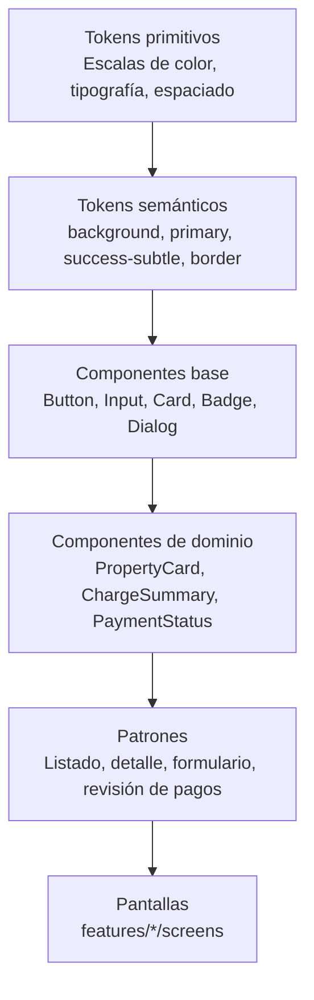

# Domzli UI · Especificación del Design System

| Campo | Valor |
|---|---|
| Versión | 1.0 — borrador para revisión |
| Fecha | 17 de noviembre de 2026 |
| Documento fuente | [Plan de producto y arquitectura v2.0](../product/plan-producto-v2.md), §6 |
| Documentos relacionados | [TAD](../architecture/TAD.md) · [ADR-0009: Design System propio](../decisions/0009-design-system-propio.md) |
| Plataformas | iOS, Android y Web (mobile-first) |
| Estado | Propuesto |

---

## Índice

1. [Principios](#1-principios)
2. [Arquitectura del sistema](#2-arquitectura-del-sistema)
3. [Tokens de diseño](#3-tokens-de-diseño)
4. [Iconografía](#4-iconografía)
5. [Componentes base](#5-componentes-base)
6. [Componentes de dominio](#6-componentes-de-dominio)
7. [Patrones de interfaz móvil y web](#7-patrones-de-interfaz-móvil-y-web)
8. [Accesibilidad](#8-accesibilidad)
9. [Contenido y formatos](#9-contenido-y-formatos)
10. [Gobernanza](#10-gobernanza)
11. [Hoja de ruta por fase](#11-hoja-de-ruta-por-fase)

---

## 1. Principios

| Principio | Qué significa en Domzli | Cómo se verifica |
|---|---|---|
| **Claridad financiera** | Montos, saldos y estados se leen de un vistazo: cifras tabulares, jerarquía tipográfica fuerte y una sola cifra protagonista por tarjeta. | Revisión de diseño de cada pantalla financiera. |
| **Minimalismo funcional** | Fondos claros, bordes sutiles, sombras discretas. La decoración nunca compite con los datos. | Ningún componente usa más de un nivel de elevación. |
| **Estado explícito** | Todo estado (pendiente, vencido, en revisión) se comunica con **texto + icono + color**, nunca solo con color. | Lint de `Badge` sin `label`; pruebas de accesibilidad. |
| **Tokens primero** | Ningún color, tamaño o espaciado se escribe a mano fuera de los tokens. | Lint que prohíbe colores hexadecimales en `src/features` y `src/app`. |
| **Mobile-first, escritorio digno** | Se diseña para 360 pt de ancho y se adapta hacia arriba. En escritorio aparecen tablas, barra lateral y atajos de teclado. | Cada componente documenta su comportamiento en los tres tamaños. |
| **Accesible por defecto** | Contraste AA, objetivos táctiles ≥ 44 pt, foco visible y roles ARIA vienen incluidos en el componente. | Lista de verificación de la sección 8. |

---

## 2. Arquitectura del sistema

### 2.1. Capas



| Capa | Ubicación | Regla |
|---|---|---|
| Tokens primitivos | `src/theme/tokens.ts` | Solo los consumen los tokens semánticos. Nunca se usan en componentes. |
| Tokens semánticos | `src/theme/tokens.ts` → `src/theme/global.css` (generado) | Lo único que usan los componentes. Cambian entre modo claro y oscuro. |
| Componentes base | `src/components/ui/` | Genéricos, sin conocimiento del negocio. |
| Layout y feedback | `src/components/layout/`, `src/components/feedback/` | Estructura de la app (shell, pantallas) y retroalimentación global (toasts, errores). |
| Componentes de dominio | `src/features/*/components/` | Componen componentes base. Reciben modelos de dominio, no filas de la base de datos. |
| Patrones | Este documento + pantallas de referencia | Recetas de composición. |

### 2.2. Stack

| Necesidad | Herramienta | Nota |
|---|---|---|
| Estilos | **NativeWind** (clases tipo Tailwind en React Native y web) | Variantes `web:`, `native:`, `ios:`, `android:`, `dark:` y por *breakpoint*. |
| Variantes | **class-variance-authority** (`cva`) | Igual que shadcn/ui. |
| Combinación de clases | `clsx` + `tailwind-merge` → `cn()` en `src/lib/cn.ts` | Permite sobrescribir con `className`. |
| Primitivas accesibles | `@rn-primitives/*` (Dialog, Select, DropdownMenu, Tabs, Tooltip, Slot, Portal) | Manejo de foco, ARIA y teclado en web. |
| Iconos | `lucide-react-native` | Envueltos para aceptar `className` (sección 4). |
| Animación | `react-native-reanimated` | Respeta "reducir movimiento". |
| Hojas inferiores | `@gorhom/bottom-sheet` (nativo) | En web se sustituye por `Dialog` (sección 7.9). |
| Listas largas | `@shopify/flash-list` | Inmuebles, cobros, pagos. |
| Imágenes | `expo-image` | Caché, *placeholders* y transiciones. |
| Fuentes | `expo-font` + `@expo-google-fonts/inter` | Incrustadas en el binario con el *config plugin*. |

Regla del plan (§6.3): **no se añade una dependencia si un componente propio sencillo es suficiente.** Las de esta tabla resuelven problemas difíciles (foco, gestos, virtualización) y están justificadas.

### 2.3. Convenciones de la API de componentes

1. **Variantes por propiedades:** `variant`, `size`, `tone`. Nunca booleanos que se excluyan entre sí (`primary`, `danger`).
2. **`className` siempre disponible** y combinado con `cn()`, de modo que la clase del consumidor gana.
3. **Composición sobre configuración:** componentes compuestos (`Card`, `CardHeader`, `CardTitle`, `CardContent`, `CardFooter`) en lugar de veinte propiedades.
4. **`asChild`** (vía `Slot`) para que un `Button` pueda envolver un `Link` de Expo Router sin anidar elementos pulsables.
5. **Herencia de texto explícita:** React Native no hereda estilos de texto de un `View`. Los contenedores con texto (`Button`, `Badge`) publican sus clases mediante `TextClassContext` y el componente `Text` las consume.
6. **Props de accesibilidad multiplataforma:** `role`, `aria-label`, `aria-disabled`, `aria-busy`, `aria-expanded`, `aria-invalid` (React Native las traduce en iOS y Android; en web se emiten tal cual).
7. **Exportar las variantes** (`buttonVariants`) para reutilizarlas en elementos que no son el componente (por ejemplo, un enlace con aspecto de botón).
8. **Nombres en inglés** (código) y documentación en español.

Ejemplo de referencia:

```tsx
// src/components/ui/button.tsx
import { cva, type VariantProps } from 'class-variance-authority';
import { Pressable, type PressableProps } from 'react-native';
import { cn } from '@/lib/cn';
import { TextClassContext } from '@/components/ui/text';
import { Spinner } from '@/components/ui/spinner';

export const buttonVariants = cva(
  'flex-row items-center justify-center gap-2 rounded-md ' +
    'web:transition-colors web:focus-visible:outline-none ' +
    'web:focus-visible:ring-2 web:focus-visible:ring-ring web:focus-visible:ring-offset-2',
  {
    variants: {
      variant: {
        default: 'bg-primary active:bg-primary-emphasis web:hover:bg-primary-emphasis',
        secondary: 'bg-secondary active:bg-secondary/80 web:hover:bg-secondary/80',
        outline: 'border border-input bg-card active:bg-muted web:hover:bg-muted',
        ghost: 'active:bg-muted web:hover:bg-muted',
        destructive: 'bg-destructive active:bg-destructive/90 web:hover:bg-destructive/90',
        link: 'px-0',
      },
      size: {
        sm: 'h-9 px-3',
        md: 'h-11 px-4 lg:h-10',
        lg: 'h-[52px] px-6',
        icon: 'h-11 w-11 lg:h-10 lg:w-10',
      },
    },
    defaultVariants: { variant: 'default', size: 'md' },
  },
);

export const buttonTextVariants = cva('font-sans-medium text-base lg:text-sm', {
  variants: {
    variant: {
      default: 'text-primary-foreground',
      secondary: 'text-secondary-foreground',
      outline: 'text-foreground',
      ghost: 'text-foreground',
      destructive: 'text-destructive-foreground',
      link: 'text-primary underline',
    },
  },
  defaultVariants: { variant: 'default' },
});

type ButtonProps = PressableProps &
  VariantProps<typeof buttonVariants> & { loading?: boolean };

export function Button({ className, variant, size, loading, disabled, children, ...props }: ButtonProps) {
  const isDisabled = Boolean(disabled || loading);
  return (
    <TextClassContext.Provider value={buttonTextVariants({ variant })}>
      <Pressable
        role="button"
        aria-disabled={isDisabled}
        aria-busy={loading}
        disabled={isDisabled}
        className={cn(buttonVariants({ variant, size }), isDisabled && 'opacity-50', className)}
        {...props}
      >
        {loading ? <Spinner size="sm" /> : null}
        {children}
      </Pressable>
    </TextClassContext.Provider>
  );
}
```

---

## 3. Tokens de diseño

### 3.1. Nomenclatura

- **Primitivos:** `{familia}-{paso}` → `brand-600`, `neutral-200`. Pasos de 50 (más claro) a 950 (más oscuro).
- **Semánticos:** por **función**, no por apariencia → `primary`, `muted-foreground`, `success-subtle`. Cada superficie tiene su pareja `*-foreground` con contraste verificado.
- **En código:** variables CSS `--color-{token}` con canales RGB separados por espacios (`72 89 221`) para permitir opacidad (`bg-primary/10`).

### 3.2. Color: escalas primitivas

Generadas en OKLCH (luminosidad perceptualmente uniforme) y convertidas a sRGB. **Marca: índigo Domzli** (tono 272°), que transmite confianza y se diferencia del verde de "pagado" y del rojo de "vencido".

| Paso | `brand` | `neutral` | `success` | `warning` | `danger` |
|---|---|---|---|---|---|
| 0 | — | `#FFFFFF` | — | — | — |
| 50 | `#F4F7FE` | `#F6F7F9` | `#EEFBF1` | `#FFF5EB` | `#FFF4F3` |
| 100 | `#E6ECFF` | `#EBEDF0` | `#DBF5E1` | `#FFE9D1` | `#FEE7E4` |
| 200 | `#D0DBFF` | `#DADCE1` | `#BCEAC7` | `#FCD5A9` | `#FFCFCB` |
| 300 | `#ADBFFF` | `#BFC2C9` | `#8DD6A1` | `#F1B66F` | `#FFA8A0` |
| 400 | `#839BFF` | `#9FA3AC` | `#59BB78` | `#DB9125` | `#FF6E68` |
| 500 | `#5E74FA` | `#80858F` | `#229D55` | `#B67405` | `#E44142` |
| 600 | **`#4859DD`** | `#676C75` | `#058141` | `#955E02` | `#C51D28` |
| 700 | `#3946BC` | `#545861` | `#036A34` | `#7B4C01` | `#A7051A` |
| 800 | `#2C379A` | `#42464F` | `#005528` | `#633D03` | `#880012` |
| 900 | `#222B78` | `#33373E` | `#01431E` | `#4E2F01` | `#6A060F` |
| 950 | `#141B52` | `#202329` | `#002C11` | `#331D01` | `#480206` |
| 975 | — | `#0F1216` | — | — | — |

### 3.3. Color: tokens semánticos

Contraste calculado con la fórmula WCAG 2.x. Texto normal ≥ 4,5:1. Componentes de interfaz y texto grande ≥ 3:1.

| Token | Claro | Oscuro | Uso | Contraste (claro · oscuro) |
|---|---|---|---|---|
| `background` | neutral-50 `#F6F7F9` | neutral-975 `#0F1216` | Lienzo de la app | — |
| `foreground` | neutral-950 `#202329` | neutral-50 `#F6F7F9` | Texto principal | 14,7 · 17,5 sobre `background` |
| `card` | `#FFFFFF` | neutral-950 `#202329` | Tarjetas, hojas, tablas | — |
| `card-foreground` | neutral-950 | neutral-50 | Texto sobre tarjeta | 15,7 · 14,7 |
| `popover` | `#FFFFFF` | neutral-900 `#33373E` | Menús, *popovers*, *tooltips* | — |
| `primary` | brand-600 `#4859DD` | brand-400 `#839BFF` | Acción principal, enlaces, selección | 5,6 · 6,1 como texto sobre `card` |
| `primary-foreground` | `#FFFFFF` | brand-950 `#141B52` | Texto sobre `primary` | 5,6 · 6,2 |
| `primary-emphasis` | brand-700 `#3946BC` | brand-300 `#ADBFFF` | Estado presionado o *hover* de `primary` | 7,6 · 8,9 con su *foreground* |
| `secondary` | neutral-100 `#EBEDF0` | neutral-800 `#42464F` | Botón secundario | — |
| `secondary-foreground` | neutral-900 `#33373E` | neutral-50 | Texto sobre `secondary` | 10,2 · 8,8 |
| `muted` | neutral-100 `#EBEDF0` | neutral-900 `#33373E` | Fondos atenuados, *skeleton*, filas alternas | — |
| `muted-foreground` | neutral-600 `#676C75` | neutral-400 `#9FA3AC` | Texto secundario, *placeholders*, metadatos | 5,3 · 6,2 sobre `card`; 4,5 · 4,7 sobre `muted` |
| `accent` | brand-50 `#F4F7FE` | brand-950 `#141B52` | Ítem seleccionado o activo en navegación | — |
| `accent-foreground` | brand-700 `#3946BC` | brand-300 `#ADBFFF` | Texto sobre `accent` | 7,1 · 8,9 |
| `destructive` | danger-600 `#C51D28` | danger-400 `#FF6E68` | Acciones destructivas | — |
| `destructive-foreground` | `#FFFFFF` | danger-950 `#480206` | Texto sobre `destructive` | 5,9 · 6,0 |
| `success` | success-600 `#058141` | success-400 `#59BB78` | Estado positivo sólido | — |
| `success-foreground` | `#FFFFFF` | success-950 `#002C11` | | 5,0 · 6,4 |
| `warning` | warning-600 `#955E02` | warning-400 `#DB9125` | Estado de atención sólido | — |
| `warning-foreground` | `#FFFFFF` | warning-950 `#331D01` | | 5,4 · 6,1 |
| `success-subtle` / `-foreground` | success-50 / success-700 | success-950 / success-300 | *Badges* y alertas "Pagado", "Aprobado" | 6,3 · 9,0 |
| `warning-subtle` / `-foreground` | warning-50 / warning-700 | warning-950 / warning-300 | "En revisión", "Por vencer" | 6,8 · 8,9 |
| `danger-subtle` / `-foreground` | danger-50 / danger-700 | danger-950 / danger-300 | "Vencido", "Rechazado" | 7,3 · 8,8 |
| `info-subtle` / `-foreground` | brand-50 / brand-700 | brand-950 / brand-300 | Información, "Invitación enviada" | 7,1 · 8,9 |
| `border` | neutral-200 `#DADCE1` | neutral-800 `#42464F` | Bordes decorativos: tarjetas, separadores | No esencial |
| `input` | neutral-500 `#80858F` | neutral-500 `#80858F` | Borde de campos, *checkbox*, *switch* apagado | 3,7 · 4,3 (≥ 3:1, WCAG 1.4.11) |
| `ring` | brand-500 `#5E74FA` | brand-400 `#839BFF` | Anillo de foco | 3,9 · 6,1 |
| `overlay` | `rgb(15 18 22 / 0.5)` | `rgb(0 0 0 / 0.6)` | Fondo de diálogos y hojas | — |

Decisiones:

- **Bordes decorativos frente a funcionales.** `border` es tenue a propósito porque una tarjeta se identifica por su contenido. Los campos de formulario usan `input`, que cumple 3:1 (WCAG 1.4.11), porque su borde es lo que los identifica.
- **Los *placeholders* usan `muted-foreground`** (≥ 4,5:1) y nunca sustituyen a la etiqueta.
- **Modo oscuro:** los tokens se definen desde ahora porque su costo es bajo, pero **se activa en F3** tras su control de calidad (el plan lo trata como capacidad futura). Hasta entonces, `userInterfaceStyle: 'light'` en la configuración de la app.

### 3.4. Color de estados del dominio

Un estado siempre se muestra con **etiqueta + icono + tono**. El tono usa las variantes *subtle* del `Badge`.

| Entidad | Estado | Etiqueta | Tono | Icono (Lucide) |
|---|---|---|---|---|
| Inmueble | `available` | Disponible | `info` | `DoorOpen` |
| | `leased` | Arrendado | `success` | `KeyRound` |
| | `maintenance` | En mantenimiento | `warning` | `Wrench` |
| | `inactive` | Inactivo | `neutral` | `CircleMinus` |
| Contrato | `draft` | Borrador | `neutral` | `FilePen` |
| | `active` | Vigente | `success` | `FileCheck` |
| | Por vencer *(derivado, ≤ 60 días)* | Vence en N días | `warning` | `CalendarClock` |
| | En prórroga *(derivado)* | En prórroga | `warning` | `CalendarClock` |
| | `terminated` | Finalizado | `neutral` | `FileX` |
| Cobro | `pending` | Pendiente | `neutral` | `Clock` |
| | Vencido *(derivado)* | Vencido | `danger` | `CircleAlert` |
| | `partially_paid` | Abonado | `warning` | `CircleDashed` |
| | `paid` | Pagado | `success` | `CircleCheck` |
| | `void` | Anulado | `neutral` (monto tachado) | `Ban` |
| Pago | `in_review` | En revisión | `warning` | `Clock` |
| | `approved` | Aprobado | `success` | `CircleCheck` |
| | `rejected` | Rechazado | `danger` | `CircleX` |
| | `cancelled` | Retirado | `neutral` | `Undo2` |
| | `reversed` | Revertido | `neutral` | `RotateCcw` |
| Acceso del inquilino | Vinculado | Con acceso | `success` | `CircleCheck` |
| | Invitación pendiente | Invitación enviada | `info` | `Mail` |
| | Invitación vencida | Invitación vencida | `warning` | `Mail` |
| | Sin invitar | Sin acceso | `neutral` | `CircleDashed` |

La correspondencia vive en un único módulo (`features/*/domain/status.ts`) y la consume `StatusBadge`. Ninguna pantalla decide colores de estado por su cuenta.

### 3.5. Visualización de datos

Los gráficos del dashboard (ingresos por mes, ingresos frente a gastos, cartera por antigüedad) usan una paleta **separada** de los colores de estado: verde y rojo están reservados para "pagado" y "vencido", así que **ingresos y gastos no se pintan de verde y rojo**.

**Categórica** (identidad de series, se asigna en orden fijo y nunca se recicla):

| Serie | Claro | Oscuro | Uso típico |
|---|---|---|---|
| `chart-1` | `#4859DD` | `#5E74FA` | Ingresos |
| `chart-2` | `#EB6834` | `#D95926` | Gastos |
| `chart-3` | `#1BAF7A` | `#199E70` | Tercera serie |
| `chart-4` | `#EDA100` | `#C98500` | Cuarta serie |
| `chart-5` | `#E87BA4` | `#D55181` | Quinta serie |

Validada con el validador de paletas: banda de luminosidad, croma mínimo, separación para daltonismo entre series adyacentes (peor ΔE 9,1 en claro y 8,4 en oscuro; objetivo ≥ 8) y distancia en visión normal (≥ 19,3). En modo claro, `chart-3`, `chart-4` y `chart-5` tienen menos de 3:1 sobre `card`, así que **los gráficos con esas series muestran etiquetas directas o la vista de tabla**. Con más de 5 series se agrupan en "Otros".

**Ordinal** (orden con significado, por ejemplo la cartera por antigüedad 0–30, 31–60, 61–90 y más de 90 días): un solo tono que se oscurece con la antigüedad. Claro: `brand-400 → brand-600 → brand-800 → brand-950`. Oscuro: `brand-600 → brand-500 → brand-400 → brand-200`. Validada (monotonía, saltos visibles y extremo claro ≥ 2:1).

**Reglas:** un solo eje Y por gráfico, líneas de 2 px, barras con extremos redondeados de 4 px, separación de 2 px entre segmentos, cuadrícula con `border` y ejes con `muted-foreground`. El texto usa siempre tokens de texto, nunca el color de la serie. En web hay *tooltip* al pasar el cursor; en móvil, al tocar. Todo gráfico tiene una vista de tabla accesible. **Implementación:** gráficos propios y sencillos sobre `react-native-svg`, que funciona en las tres plataformas; se evaluará una librería si la complejidad crece.

### 3.6. Tipografía

**Familia: Inter** (Rasmus Andersson, licencia OFL). Alta legibilidad en tamaños pequeños, soporte completo del español y **cifras tabulares** (`tnum`) para alinear montos.

| Rol | Tamaño / interlineado | Peso | Espaciado | Uso |
|---|---|---|---|---|
| `display` | 32/40 · 36/44 desde `lg` | 700 | −0,5 | Cifra protagonista del dashboard |
| `h1` | 28/36 | 700 | −0,25 | Título grande de pantalla principal |
| `h2` | 22/28 | 600 | 0 | Título de sección |
| `h3` | 18/24 | 600 | 0 | Título de diálogo o tarjeta destacada |
| `title` | 16/24 | 600 | 0 | Título de ítem de lista o tarjeta |
| `body` | 16/24 | 400 | 0 | Texto general y valores de formulario |
| `body-sm` | 14/20 | 400 | 0 | Texto secundario, celdas de tabla en web |
| `label` | 14/20 | 500 | 0 | Etiquetas de formulario |
| `caption` | 12/16 | 400 | 0 | Metadatos, ayudas, fechas relativas |
| `overline` | 12/16 | 600 | +0,5, mayúsculas | Encabezados de grupo (con moderación) |

Reglas:

- **Pesos como familias.** Android no sintetiza pesos de fuentes personalizadas, así que cada peso es una familia: `font-sans` (400), `font-sans-medium` (500), `font-sans-semibold` (600) y `font-sans-bold` (700). Las utilidades `font-medium`, `font-semibold` y `font-bold` están prohibidas por lint.
- **Cifras:** todo monto usa `tabular-nums` (lo aplica `MoneyText`).
- **Tamaño mínimo:** 12 pt. **En campos de texto en web móvil, 16 px como mínimo**, para que Safari en iOS no haga zoom al enfocar.
- **Texto dinámico:** se respeta el tamaño de fuente del sistema. Solo en componentes densos (pestañas, *badges*) se limita con `maxFontSizeMultiplier={1.5}`. Las pantallas se prueban al 200 %.
- **Longitud de línea:** 45–75 caracteres en texto corrido (ancho máximo de lectura de 720 px en web).
- Componente `Text` con `variant` para los roles; los títulos llevan `role="heading"` y `aria-level`.

### 3.7. Espaciado y layout

Escala base de **4 pt** (la escala por defecto de Tailwind: `1` = 4 pt). Pasos permitidos: `0, 0.5, 1, 1.5, 2, 3, 4, 5, 6, 8, 10, 12, 16`.

| Token de layout | Compacto (< 768) | Medio (768–1023) | Expandido (≥ 1024) |
|---|---|---|---|
| Margen lateral de pantalla | 16 | 24 | 32 |
| Separación entre secciones | 24 | 24 | 32 |
| Relleno de tarjeta | 16 | 20 | 24 |
| Separación entre campos de formulario | 16 | 16 | 20 |
| Separación en rejillas de tarjetas | 12 | 16 | 16 |
| Ancho máximo de contenido | 100 % | 100 % | 1280 (dashboard), 720 (lectura), 640 (formularios) |
| Altura mínima de ítem de lista | 56 (una línea) · 72 (dos líneas) | igual | 48 en tablas |

### 3.8. Radios

| Token | Valor | Uso |
|---|---|---|
| `rounded-xs` | 4 | *Checkbox*, chips internos |
| `rounded-sm` | 6 | *Badges*, *tooltips* |
| `rounded-md` | 8 | Botones, campos, *selects* |
| `rounded-lg` | 12 | Tarjetas, alertas, imágenes |
| `rounded-xl` | 16 | Diálogos y hojas inferiores (esquinas superiores) |
| `rounded-full` | 9999 | Avatares, *switch*, indicadores |

### 3.9. Bordes

- Ancho por defecto: **1 px** (`border`). Separadores en listas nativas: *hairline* (`border-hairline`, `StyleSheet.hairlineWidth`).
- Color: `border` para lo decorativo, `input` para controles y `ring` para el foco.
- Campo con error: borde `destructive` **+** mensaje de texto **+** icono.

### 3.10. Elevación

El minimalismo pide **bordes antes que sombras**. Solo tres niveles:

| Nivel | Uso | Valor (modo claro) |
|---|---|---|
| `elevation-0` | Tarjetas, listas | Sin sombra; borde `border` |
| `elevation-1` | Menús, *popovers*, *selects* abiertos | `0 4px 12px rgb(15 18 22 / 0.08), 0 1px 3px rgb(15 18 22 / 0.06)` |
| `elevation-2` | Diálogos, hojas inferiores, *toasts* | `0 12px 32px rgb(15 18 22 / 0.12)` |

Se implementan con la propiedad de estilo `boxShadow` (React Native ≥ 0.76 con la Nueva Arquitectura), que funciona igual en las tres plataformas. **En modo oscuro las sombras no se ven**: la elevación se expresa con una superficie más clara (`card` → `popover`) y borde.

### 3.11. Tamaños

| Elemento | Valor |
|---|---|
| Objetivo táctil mínimo | **44 × 44 pt**. Si el elemento visible es más pequeño, se amplía con `hitSlop`. Separación ≥ 8 pt entre objetivos. |
| Altura de controles | `sm` 36 · `md` 44 (40 desde `lg`) · `lg` 52 |
| Iconos | 16 (en línea, *badges*) · 20 (por defecto en controles y listas) · 24 (navegación, encabezados) · 32 (estados vacíos) |
| Avatares | 24 · 32 · 40 · 56 |
| Barra inferior de navegación | 56 + área segura inferior |
| Encabezado móvil | 56 (título estándar) · 96 (título grande) |
| Barra lateral web | 256 (expandida) · 72 (riel) |

### 3.12. Movimiento

| Token | Duración | Curva | Uso |
|---|---|---|---|
| `motion-fast` | 100 ms | `cubic-bezier(0.2, 0, 0, 1)` | Retroalimentación al presionar, *hover* |
| `motion-base` | 200 ms | `cubic-bezier(0.2, 0, 0, 1)` | Acordeones, *fades*, *tooltips* |
| `motion-slow` | 300 ms | Entrada `cubic-bezier(0.2, 0, 0, 1)` · salida `cubic-bezier(0.3, 0, 1, 1)` | Diálogos, hojas, *toasts* |

Con "reducir movimiento" activado (`useReducedMotion` de Reanimated) se sustituyen desplazamientos por *fades* de 100 ms y se desactiva el pulso de los *skeletons*. Las listas largas no animan la entrada de sus ítems.

### 3.13. Capas y opacidad

- **Capas (web):** `base 0 · sticky 10 · header 20 · dropdown 30 · overlay 40 · modal 50 · toast 60`. En nativo se usan *portales* (`PortalHost`) en lugar de `zIndex`.
- **Opacidad:** deshabilitado `0.5`; `overlay` según la tabla de color.

### 3.14. *Breakpoints*

| Nombre | Rango (ancho) | Clase NativeWind | Navegación del arrendador |
|---|---|---|---|
| Compacto | < 768 | (base) | Barra inferior |
| Medio | 768–1023 | `md:` | Riel lateral con iconos y etiqueta |
| Expandido | ≥ 1024 | `lg:` | Barra lateral completa |
| Amplio | ≥ 1280 | `xl:` | Barra lateral + panel de detalle |

Los cambios de **estilo** usan clases (`md:`, `lg:`); los cambios de **estructura** (qué componente se renderiza) usan `useBreakpoint()`.

### 3.15. Implementación de los tokens

**Fuente única de verdad:** `src/theme/tokens.ts`. Un script (`pnpm tokens:build`) genera `src/theme/global.css`; el CI falla si el archivo generado no coincide. Los consumidores sin `className` (color de iconos, tema de la navegación, `StatusBar`, gráficos) leen `tokens.ts` mediante `useThemeColors()`.

```css
/* src/theme/global.css — GENERADO, no editar */
@tailwind base;
@tailwind components;
@tailwind utilities;

:root {
  --color-background: 246 247 249;
  --color-foreground: 32 35 41;
  --color-card: 255 255 255;
  --color-primary: 72 89 221;
  --color-primary-foreground: 255 255 255;
  --color-primary-emphasis: 57 70 188;
  --color-muted-foreground: 103 108 117;
  --color-input: 128 133 143;
  --color-ring: 94 116 250;
  /* … resto de tokens semánticos … */
}

.dark:root {
  --color-background: 15 18 22;
  --color-foreground: 246 247 249;
  --color-card: 32 35 41;
  --color-primary: 131 155 255;
  --color-primary-foreground: 20 27 82;
  /* … */
}
```

```js
// tailwind.config.js
const { hairlineWidth } = require('nativewind/theme');
const color = (name) => `rgb(var(--color-${name}) / <alpha-value>)`;

module.exports = {
  content: ['./src/**/*.{ts,tsx}'],
  presets: [require('nativewind/preset')],
  darkMode: 'class',
  theme: {
    extend: {
      colors: {
        background: color('background'),
        foreground: color('foreground'),
        card: { DEFAULT: color('card'), foreground: color('card-foreground') },
        popover: { DEFAULT: color('popover'), foreground: color('popover-foreground') },
        primary: {
          DEFAULT: color('primary'),
          foreground: color('primary-foreground'),
          emphasis: color('primary-emphasis'),
        },
        secondary: { DEFAULT: color('secondary'), foreground: color('secondary-foreground') },
        muted: { DEFAULT: color('muted'), foreground: color('muted-foreground') },
        accent: { DEFAULT: color('accent'), foreground: color('accent-foreground') },
        destructive: { DEFAULT: color('destructive'), foreground: color('destructive-foreground') },
        success: {
          DEFAULT: color('success'),
          foreground: color('success-foreground'),
          subtle: color('success-subtle'),
          'subtle-foreground': color('success-subtle-foreground'),
        },
        // warning, danger e info siguen el mismo patrón
        border: color('border'),
        input: color('input'),
        ring: color('ring'),
      },
      borderRadius: { xs: '4px', sm: '6px', md: '8px', lg: '12px', xl: '16px' },
      borderWidth: { hairline: hairlineWidth() },
      fontFamily: {
        sans: ['Inter_400Regular'],
        'sans-medium': ['Inter_500Medium'],
        'sans-semibold': ['Inter_600SemiBold'],
        'sans-bold': ['Inter_700Bold'],
      },
    },
  },
};
```

---

## 4. Iconografía

- **Librería:** Lucide (`lucide-react-native`), trazo de **2 px**, esquinas redondeadas, coherente con Inter.
- **Color:** hereda el del texto vía `className` (`text-muted-foreground`). Los iconos se envuelven con `cssInterop` para aceptar `className`.
- **Tamaños:** 16, 20 y 24 (sección 3.11). Nunca escalados de forma arbitraria.
- **Accesibilidad:** los iconos decorativos se ocultan a los lectores de pantalla. Los botones de solo icono **exigen** `aria-label`.
- **Logos de terceros** (Nequi, Daviplata, Bre-B, bancos): solo con autorización de la marca. Por defecto, icono genérico + nombre.

| Concepto | Icono | Concepto | Icono |
|---|---|---|---|
| Inicio | `House` | Pagos / comprobantes | `Receipt` |
| Inmuebles | `Building2` | Documentos | `FolderOpen` |
| Inquilinos | `Users` | Cuenta | `CircleUser` |
| Contratos | `FileText` | Más | `Ellipsis` |
| Finanzas | `Wallet` | Notificaciones | `Bell` |
| Transferencia / PSE | `Landmark` | Efectivo | `Banknote` |
| Billetera móvil | `Smartphone` | Tarjeta | `CreditCard` |
| Bre-B | `Zap` | Otro método | `CircleDollarSign` |
| Agregar | `Plus` | Subir archivo | `Upload` |
| Llamar | `Phone` | WhatsApp / mensaje | `MessageCircle` |
| Correo | `Mail` | Fecha | `CalendarDays` |

---

## 5. Componentes base

### 5.1. Formato de ficha

Cada componente documenta: **propósito**, **anatomía**, **variantes**, **tamaños**, **estados**, **comportamiento por plataforma**, **accesibilidad** y **reglas de uso**. Las fichas completas de esta sección cubren los componentes que más condicionan la experiencia; los demás se resumen en la tabla 5.10.

Estados comunes a todo control interactivo:

| Estado | Tratamiento visual | Plataforma |
|---|---|---|
| Por defecto | Según la variante | Todas |
| *Hover* | Fondo `muted` o `*-emphasis` | Solo web (`web:hover:`) |
| Presionado | Fondo `*-emphasis` o `muted`, 100 ms | Todas (`active:`) |
| Foco visible | Anillo de 2 px `ring` con separación de 2 px | Web con teclado (`web:focus-visible:`) |
| Deshabilitado | Opacidad 0,5; sin respuesta táctil; `aria-disabled` | Todas |
| Cargando | *Spinner* + etiqueta conservada; bloquea doble envío; `aria-busy` | Todas |
| Inválido | Borde `destructive` + mensaje + icono; `aria-invalid` | Campos |

### 5.2. Button

- **Propósito:** ejecutar una acción.
- **Anatomía:** contenedor · [icono inicial] · etiqueta · [icono final] · [*spinner*].
- **Variantes:** `default` (acción principal) · `secondary` · `outline` · `ghost` · `destructive` · `link`.
- **Tamaños:** `sm` 36 · `md` 44 (40 en `lg`) · `lg` 52 (CTA fijo en el pie en móvil) · `icon` 44 × 44.
- **Reglas:**
  - **Una sola acción `default` por vista.** Las demás son `secondary`, `outline` o `ghost`.
  - Etiqueta = **verbo + objeto**: "Registrar pago", "Crear contrato". Nunca "Aceptar" ni "OK" en acciones con consecuencias.
  - `destructive` solo para acciones que eliminan o anulan, y siempre con confirmación (sección 7.11).
  - Al enviar: `loading` hasta la respuesta del servidor. **Nunca** se muestra éxito antes de la confirmación del backend.
- **Plataforma:** en móvil, los CTA de formularios van fijos en el pie y ocupan todo el ancho; en web se alinean a la derecha, con la acción principal al final.
- **Accesibilidad:** `role="button"`; los botones de solo icono requieren `aria-label`.

### 5.3. Input, Textarea y MoneyInput

- **Anatomía:** contenedor · [icono inicial] · texto · [acción final: limpiar o mostrar contraseña].
- **Tipos:** `text`, `email` (teclado de correo, sin autocorrección), `password` (alternar visibilidad), `phone` (teclado telefónico, prefijo +57), `number`, `search`.
- **Tamaños:** `md` 44 (40 en `lg`) · `sm` 36 (filtros de tablas en web).
- **Estados:** por defecto (borde `input`), foco (borde `primary` + anillo `ring` en web), inválido, deshabilitado y solo lectura (fondo `muted`).
- **`Textarea`:** crece de 3 a 8 líneas; contador opcional ("120/500").
- **`MoneyInput`** *(propuesto)*: teclado numérico; formato en vivo `$ 1.250.000`; **valor interno en pesos enteros como cadena**, sin decimales para COP; `aria-label` con la cantidad en palabras opcional. Pegar "1.250.000" o "1250000" produce el mismo valor.
- **Autocompletado:** `autoComplete` / `textContentType` correctos (`email`, `password`, `new-password`, `name`, `tel`) para que funcionen los gestores de contraseñas.

### 5.4. FormField

- **Propósito:** unir etiqueta, control, descripción y error con la semántica correcta.
- **Anatomía:** `Label` · control · `Description` (opcional) · `ErrorMessage`.
- **Reglas:**
  - La etiqueta está **siempre visible** encima del control. El *placeholder* nunca la sustituye.
  - Como la mayoría de campos son obligatorios, se marcan los **opcionales** con "(opcional)".
  - Validación al salir del campo y al enviar; el error se limpia mientras se corrige.
  - Al enviar con errores: foco en el primer campo inválido y, en formularios largos, un resumen de errores en la parte superior.
- **Integración:** envuelve `Controller` de React Hook Form; los mensajes vienen del esquema Zod (en español).
- **Accesibilidad:** el control referencia la descripción y el error (`aria-describedby` en web, `accessibilityHint` en nativo); `aria-invalid` cuando hay error; el error se anuncia.

### 5.5. Select y DatePicker

**Select**
- **Nativo:** abre una **hoja inferior** con la lista de opciones; con más de 8 opciones incluye búsqueda.
- **Web:** *listbox* en *popover* con navegación por flechas, escritura para buscar, `Enter` para elegir y `Esc` para cerrar.
- **Reglas:** de 2 a 5 opciones visibles a la vez → `RadioGroup` o `SegmentedControl`; más de 5 → `Select`.

**DatePicker**
- **Valor:** siempre una cadena **`'YYYY-MM-DD'`**, nunca un objeto `Date`, para evitar desfases de zona horaria (TAD §6.4).
- **Nativo:** campo que abre un calendario propio en hoja inferior (aspecto consistente en iOS y Android).
- **Web:** campo con escritura enmascarada `dd/mm/aaaa` + calendario en *popover*.
- **Calendario:** semana iniciando en lunes, nombres en español, `minDate`/`maxDate`, días deshabilitados con explicación, navegación por teclado en web.
- **`DateRangePicker`** (F2, filtros financieros): atajos "Este mes", "Mes anterior", "Últimos 3 meses", "Este año".

### 5.6. Badge y StatusBadge

- **Anatomía:** [icono 16 o punto] · etiqueta.
- **Tonos:** `neutral` · `info` · `success` · `warning` · `danger` (variantes *subtle*) · `outline`.
- **Tamaños:** `sm` (altura 20, `caption`) · `md` (altura 24, `body-sm`).
- **`StatusBadge`** recibe `entity` y `status` y aplica la tabla 3.4. Es la única forma permitida de mostrar estados del dominio.
- **Reglas:** la etiqueta es obligatoria (sin *badges* de solo color); no son pulsables (para filtrar se usan `FilterChip`).

### 5.7. Card

- **Composición:** `Card` · `CardHeader` (`CardTitle`, `CardDescription`, acción opcional) · `CardContent` · `CardFooter`.
- **Variantes:** `default` (fondo `card`, borde `border`, `rounded-lg`) · `interactive` (pulsable entera, con estados presionado y *hover*) · `muted` (fondo `muted`, sin borde, para agrupar dentro de otra tarjeta).
- **Reglas:** una tarjeta interactiva tiene **un único destino**; las acciones secundarias van en un menú (`Ellipsis`) para no anidar elementos pulsables.
- **Accesibilidad:** la tarjeta interactiva es `role="button"` (o enlace en web) con una etiqueta que resume su contenido ("Apto 301, Medellín, arrendado, canon 1.200.000 pesos").

### 5.8. Dialog, AlertDialog, Sheet y ActionSheet

| Componente | Cuándo | Nativo | Web |
|---|---|---|---|
| `Dialog` | Tareas cortas que requieren foco (editar un dato, ver un detalle) | Modal centrado (tableta) u hoja (teléfono), ver 7.9 | Modal centrado, ancho 480–640 |
| `AlertDialog` | Confirmar acciones destructivas o financieras | Modal centrado, ancho 320 | Modal centrado, ancho 420 |
| `Sheet` | Formularios secundarios, filtros, selección | Hoja inferior con asa, ajuste por contenido, arrastrar para cerrar | Panel lateral derecho (ancho 400–480) |
| `ActionSheet` | Lista de acciones sobre un elemento | Hoja inferior con opciones; la destructiva en rojo; "Cancelar" separado | `DropdownMenu` anclado al disparador |

Comportamiento común: fondo `overlay`; **trampa de foco** y devolución del foco al disparador al cerrar (web); `Esc` cierra (web); botón atrás de Android cierra; título obligatorio (`aria-labelledby`). El `AlertDialog` **no se cierra al tocar fuera**.

### 5.9. Toast y Alert

**Toast** (retroalimentación transitoria):
- **Tonos:** `success`, `info`, `warning`, `error`.
- **Posición:** móvil, abajo, por encima de la barra de navegación; web, abajo a la derecha.
- **Duración:** 4 s; 6 s si tiene acción ("Deshacer", "Ver"). Uno visible a la vez en móvil y hasta 3 apilados en web.
- **Reglas:** solo para confirmar acciones completadas ("Pago aprobado"). **Los errores que requieren acción no van en un toast**: van en `Alert` o junto al campo.
- **Accesibilidad:** se anuncia al lector de pantalla (`AccessibilityInfo.announceForAccessibility` en nativo, `aria-live="polite"` en web).

**Alert** (mensaje persistente dentro de la página):
- **Tonos:** `info`, `success`, `warning`, `danger`.
- **Anatomía:** icono · título · descripción · [acción].
- **Usos:** "Este pago fue rechazado: el comprobante no es legible", "El contrato vence en 30 días", "Aprobar no confirma que el dinero llegó a tu cuenta".

### 5.10. Resumen del resto de componentes base

| Componente | Variantes / tamaños | Notas de comportamiento | Plataforma |
|---|---|---|---|
| `Text` | Roles de la tabla 3.6 | Consume `TextClassContext`; títulos con `role="heading"` | Todas |
| `Checkbox` | `md` (visual 20, táctil 44) | Estados marcado, sin marcar e indeterminado; etiqueta pulsable | Todas |
| `Switch` | `md` | Solo para ajustes de **efecto inmediato**; en formularios con "Guardar" se usa `Checkbox` | Todas |
| `RadioGroup` | Vertical · horizontal | 2–5 opciones; flechas para moverse en web | Todas |
| `SegmentedControl` *(propuesto)* | 2–4 segmentos | Cambia de vista dentro de una pantalla (Mensual / Anual) | Todas |
| `IconButton` | `ghost` · `outline` · `secondary`; 36 / 44 | `aria-label` obligatorio; *tooltip* en web | Todas |
| `DropdownMenu` | — | Web: menú con teclado. Nativo: delega en `ActionSheet` | Todas |
| `Avatar` | 24 · 32 · 40 · 56 | Imagen o iniciales sobre `muted`; nunca un color por usuario | Todas |
| `Separator` | Horizontal · vertical | `hairline` en listas nativas | Todas |
| `Tabs` | `underline` (nivel de página) · `pills` (dentro de tarjeta) | Desplazables si no caben; flechas en web; `role="tablist"` | Todas |
| `Accordion` | Simple · múltiple | Animación `motion-base`; `aria-expanded` | Todas |
| `Skeleton` | Línea · bloque · círculo | Reproduce la forma del contenido; pulso desactivado con "reducir movimiento" | Todas |
| `Progress` *(propuesto)* | Barra · anillo | Recaudo del mes, vigencia del contrato; valor textual siempre visible | Todas |
| `ListItem` *(propuesto)* | 1, 2 o 3 líneas; con *leading*, *trailing* y *chevron* | Altura mínima 56/72; separador *hairline* | Todas |
| `EmptyState` | Primera vez · sin resultados · sin permisos | Icono 32 en círculo `muted` + título + descripción + **una** acción | Todas |
| `LoadingState` | Sección · pantalla completa | Preferir `Skeleton`; *spinner* solo si la espera es indeterminada y corta | Todas |
| `ErrorState` | Sección · pantalla completa | Mensaje humano + "Reintentar"; código técnico solo en desarrollo | Todas |
| `OfflineBanner` *(propuesto)* | — | "Sin conexión. Mostrando datos guardados." Fijo bajo el encabezado | Todas |
| `SearchInput` *(propuesto)* | — | Búsqueda con espera de 300 ms; botón limpiar; `role="search"` | Todas |
| `FilterChip` *(propuesto)* | Seleccionado · no seleccionado | Filtros rápidos en listas móviles; contador de filtros activos | Todas |
| `FileUploader` *(propuesto)* | Imagen · PDF | Nativo: cámara, galería o archivos. Web: arrastrar y soltar + selector. Progreso, reintento y validación de tipo y tamaño | Archivos `.native` / `.web` |
| `Header` | Estándar · título grande · modal | Atrás, título y hasta 2 acciones; en web lo reemplaza `PageHeader` | Nativo |
| `PageHeader` *(propuesto)* | — | `Breadcrumb` + título + descripción + acciones a la derecha | Web (≥ md) |
| `BottomNavigation` | 4–5 destinos | Icono + etiqueta siempre visibles; *badge* numérico | Compacto |
| `Sidebar` | Expandida · riel | Selector de organización arriba y menú de usuario abajo; contraíble | Medio / expandido |
| `Breadcrumb` | — | Solo web; el último nivel no es enlace | Web |
| `Pagination` | — | Web: páginas + tamaño de página (20/50/100). Nativo: *scroll* infinito | Web |
| `Table` / `DataTable` | Densidad cómoda · compacta | Ver 7.8; en compacto se transforma en lista de tarjetas | `.web` / `.native` |

---

## 6. Componentes de dominio

Viven en `src/features/*/components`, se construyen **solo** con componentes base y reciben **modelos de dominio** (no filas de la base de datos).

| Componente | Contenido | Variantes | Interacción |
|---|---|---|---|
| **`PropertyCard`** | Foto de portada (16:9, *placeholder* con icono `Building2`), nombre, dirección (1 línea), barrio y ciudad, `StatusBadge`, canon vigente (`MoneyText`), inquilino titular (avatar + nombre) o "Disponible" | `card` (rejilla y lista móvil) · `row` (lista compacta y tabla) · `selectable` (asistente de contrato) | Toda la tarjeta abre el detalle; menú `Ellipsis` con acciones |
| **`TenantCard`** | Avatar, nombre, documento enmascarado ("CC •••• 4321"), teléfono, estado de acceso (`StatusBadge`), contratos asociados | `card` · `row` | Acciones rápidas: llamar, WhatsApp (`wa.me/57…`), correo, invitar o reenviar invitación |
| **`LeaseCard`** | Inmueble, titular, fechas de inicio y fin, `Progress` de la vigencia, días restantes, canon, `StatusBadge` (incluidos "Por vencer" y "En prórroga") | `card` · `row` · `summary` (en el portal del inquilino) | Abre el detalle del contrato |
| **`ChargeSummary`** | Período ("Noviembre 2026"), conceptos con sus montos, total, pagado, **saldo**, vencimiento ("Vence el 5 nov" / "Venció hace 3 días"), `StatusBadge` | `compact` (lista) · `full` (detalle) | Inquilino: CTA "Reportar pago". Arrendador: "Registrar pago" y menú (anular) |
| **`PaymentCard`** | Monto, fecha de pago, método (icono + nombre), referencia, miniatura del comprobante, quién lo reportó, `PaymentStatus` | `card` · `row` | Arrendador: "Revisar" si está en revisión. Inquilino: ver detalle o retirar el reporte |
| **`PaymentStatus`** | `StatusBadge` + explicación contextual (motivo del rechazo, fecha y responsable de la aprobación) | `inline` · `block` | — |
| **`FinancialSummary`** | Rejilla de `StatTile`: ingresos del período, pendiente, cartera vencida, ocupación. Cada uno con valor, comparación con el período anterior (texto + flecha) y enlace al listado filtrado | 2 columnas (compacto) · 4 columnas (expandido) | Tocar un indicador abre su listado filtrado |
| **`PropertyGallery`** | Fotos del inmueble | `viewer` (carrusel con indicador "3/12" en móvil; rejilla + visor en web) · `editor` (agregar, reordenar, portada, eliminar; máximo 20) | Zoom con gesto; teclado en web |
| **`MoneyText`** *(propuesto)* | Monto formateado `es-CO` con cifras tabulares | Tamaños según el rol tipográfico; `tone` (por defecto o atenuado); `strikethrough` (anulado) | — |
| **`ReceiptViewer`** *(propuesto)* | Imagen con zoom o PDF; descarga | En línea · pantalla completa | URL firmada que se renueva al expirar |
| **`AccountStatement`** *(propuesto)* | Estado de cuenta del inquilino: saldo total, próximos vencimientos, historial de cobros y pagos | — | Filtro por año |
| **`OrgSwitcher`** *(propuesto)* | Organización y rol activos | Encabezado (móvil) · barra lateral (web) | Cambia el contexto (TAD §7.4) |

**Contrato de datos (ejemplo):**

```ts
type PropertyCardProps = {
  property: {
    id: string;
    name: string;
    addressLine: string;
    city: string;
    status: PropertyStatus;
    coverPhotoUrl?: string;
    currentRentCents?: number;      // centavos enteros (ADR-0008)
    primaryTenant?: { name: string; avatarUrl?: string };
  };
  variant?: 'card' | 'row' | 'selectable';
  selected?: boolean;
  onPress?: () => void;
};
```

---

## 7. Patrones de interfaz móvil y web

### 7.1. Estructura de la aplicación (*app shell*)

**Arrendador**

| Sección | Compacto (barra inferior) | Medio (riel) | Expandido (barra lateral) |
|---|---|---|---|
| Inicio | ✅ Pestaña | ✅ | ✅ |
| Inmuebles | ✅ Pestaña | ✅ | ✅ |
| Contratos | ✅ Pestaña | ✅ | ✅ |
| Finanzas | ✅ Pestaña | ✅ | ✅ |
| Inquilinos | Dentro de "Más" | ✅ | ✅ |
| Cuenta | Dentro de "Más" | ✅ (abajo) | Menú de usuario (abajo) |

El plan define 6 secciones, pero las guías de iOS y Android recomiendan **de 3 a 5 pestañas**. Se propone **Inicio · Inmuebles · Contratos · Finanzas · Más**, con Inquilinos como primera opción de "Más" y accesible también desde las fichas de contrato e inmueble. **Validar en pruebas con usuarios**; la alternativa es intercambiar Contratos e Inquilinos.

**Inquilino:** Inicio · Mi contrato · Pagos · Documentos · Cuenta (5 pestañas, sin cambios respecto al plan). En web, las mismas secciones en una barra lateral sencilla.

```text
Escritorio (≥ 1024)
┌─────────────┬────────────────────────────────────────────────┐
│ Domzli      │ Inmuebles › Apto 301                           │
│ Mi org.   ▾ ├────────────────────────────────────────────────┤
│             │ Inmuebles                    [+ Nuevo inmueble]│
│ Inicio      │ [Buscar…] [Estado ▾] [Ciudad ▾]      Vista ▤ ▦ │
│ Inmuebles  ●│ ┌───────────┬──────────┬───────────┬────────┐  │
│ Inquilinos  │ │ Inmueble  │ Ciudad   │ Estado    │ Canon  │  │
│ Contratos   │ ├───────────┼──────────┼───────────┼────────┤  │
│ Finanzas    │ │ Apto 301  │ Medellín │ Arrendado │ 1,2 M  │  │
│             │ │ Casa 12   │ Envigado │ Disponible│ 2,5 M  │  │
│ ─────────── │ └───────────┴──────────┴───────────┴────────┘  │
│ Ana López ▾ │                       ‹ 1 2 3 ›  20 por página │
└─────────────┴────────────────────────────────────────────────┘
```

### 7.2. Dashboard

Orden por **urgencia**, no por tipo de dato:

1. **Cifra protagonista:** ingresos del período frente a lo esperado (`display` + `Progress`).
2. **Indicadores:** pendiente, cartera vencida, ocupación (inmuebles arrendados / total).
3. **"Requiere tu atención":** pagos en revisión, cobros vencidos y contratos por vencer, con contador y enlace. Si no hay nada: "Todo al día".
4. **Acciones rápidas:** Registrar inmueble, Registrar inquilino, Crear contrato, Registrar pago (plan §3.1).
5. En expandido: gráfico de ingresos de los últimos 12 meses y actividad reciente.

```text
Móvil (360 pt)
┌──────────────────────────────┐
│ Hola, Ana          [Campana] │
│ Mi organización ▾            │
├──────────────────────────────┤
│ Ingresos de noviembre        │
│ $ 8.450.000                  │
│ de $ 9.800.000 esperados     │
│ ████████████████░░░   86 %   │
├──────────────┬───────────────┤
│ Pendiente    │ Vencido       │
│ $ 1.350.000  │ $ 600.000     │
│ 3 cobros     │ 1 cobro       │
├──────────────┴───────────────┤
│ Requiere tu atención         │
│  2 pagos en revisión       › │
│  Apto 301 vence en 28 días › │
├──────────────────────────────┤
│ [+ Inmueble]   [+ Inquilino] │
│ [+ Contrato]   [+ Pago]      │
├──────────────────────────────┤
│ Inicio Inmueb Contr. Fin. Más│
└──────────────────────────────┘
```

**Primera vez:** el dashboard vacío muestra una lista de primeros pasos con progreso (registrar inmueble → registrar inquilino → crear contrato → invitar al inquilino).

### 7.3. Listados

| Elemento | Compacto | Expandido |
|---|---|---|
| Búsqueda | `SearchInput` fijo bajo el encabezado | En la barra de herramientas de la tabla |
| Filtros | `FilterChip` horizontales + "Filtros" en `Sheet` | `Select` en línea + "Más filtros" en `Sheet` lateral |
| Resultados | `FlashList` de tarjetas o `ListItem` | `DataTable` (7.8), con alternancia tabla / rejilla en inmuebles |
| Carga | `Skeleton` con la forma de la tarjeta | `Skeleton` de filas |
| Actualizar | Deslizar hacia abajo | Botón "Actualizar" + refresco al volver a la pestaña |
| Paginación | *Scroll* infinito (lotes de 20) | `Pagination` |
| Acción principal | Botón `+` en el encabezado | Botón `default` en `PageHeader` |
| Vacío | `EmptyState` "primera vez" o "sin resultados" (con "Limpiar filtros") | Igual |

Los filtros aplicados se reflejan en la URL en web (`?status=leased`) y se recuerdan por sesión en móvil.

### 7.4. Detalle de una entidad

- **Encabezado de resumen:** identidad (foto, nombre), `StatusBadge`, 2–3 datos clave (canon, inquilino, vencimiento) y acciones principales.
- **Pestañas** (`Tabs` `underline`): por ejemplo, para el inmueble, *Resumen · Contrato · Finanzas · Documentos · Historial*.
- **Expandido:** patrón **maestro-detalle** a partir de `xl` (lista a la izquierda, detalle a la derecha) para revisar varios elementos sin perder el contexto.
- **Historial:** línea de tiempo con la auditoría (quién, qué y cuándo) en lenguaje natural ("Ana aprobó un pago de $ 1.200.000").

### 7.5. Formularios

- **Una columna** en móvil; en escritorio, dos columnas solo para campos cortos relacionados (ciudad + barrio).
- **Agrupar** en secciones con título (`h3`) y orden lógico.
- **Teclado:** `KeyboardAvoidingView` / `KeyboardAwareScrollView`; "Siguiente" avanza al próximo campo; el último campo envía.
- **Acciones:** fijas en el pie en móvil (`Button` `lg` a todo el ancho); en web, al final del formulario y alineadas a la derecha.
- **Salir con cambios sin guardar:** `AlertDialog` "¿Descartar cambios?".
- **Valores por defecto inteligentes:** ciudad de la organización, día de pago 5, `administration_mode` según el inmueble.
- **Formatos:** fechas `dd/mm/aaaa`; montos `MoneyInput`; teléfono con +57; documento con tipo (CC, CE, PA, PPT, NIT) + número.

### 7.6. Flujos de varios pasos (asistente de contrato)

Pasos del flujo 10.4 del plan: **Inmueble → Inquilino → Condiciones → Fechas → Documento → Confirmar**.

- Indicador de progreso "Paso 2 de 6" + título del paso (no solo puntos).
- Cada paso valida su propio esquema Zod antes de avanzar. "Atrás" no pierde datos.
- El progreso se guarda como **borrador en el servidor** (`leases.status = 'draft'`): el usuario puede salir y continuar después.
- El paso **Confirmar** resume todo en tarjetas editables ("Editar" vuelve al paso) y explica el efecto: "El inmueble pasará a Arrendado y [inquilino] podrá ver este contrato".
- En expandido, los pasos se muestran en una columna lateral y el contenido a la derecha.

### 7.7. Revisión de pagos (arrendador)

```text
Móvil
┌──────────────────────────────┐
│ ‹  Revisar pago              │
├──────────────────────────────┤
│ ┌──────────────────────────┐ │
│ │  [comprobante]           │ │
│ │  Toca para ampliar       │ │
│ └──────────────────────────┘ │
│ Monto reportado  $ 1.200.000 │
│ Fecha de pago     14 nov 2026│
│ Método                 Bre-B │
│ Referencia            84731… │
│ Inquilino         Juan Pérez │
│ ──────────────────────────── │
│ Se aplicará a                │
│ Canon noviembre  $ 1.200.000 │
│ Saldo después de aprobar  $ 0│
│ ⓘ Aprobar no confirma que el │
│   dinero llegó a tu cuenta.  │
├──────────────────────────────┤
│ [ Rechazar ]   [  Aprobar  ] │
└──────────────────────────────┘
```

- **Expandido:** comprobante a la izquierda (visor grande) y datos y acciones a la derecha; la cola de pagos en revisión se recorre sin volver a la lista.
- **Rechazar** abre un `Sheet` con **motivo obligatorio** y motivos frecuentes como sugerencias ("Comprobante ilegible", "Monto no coincide", "No se encontró la transferencia").
- **Aprobar** muestra el efecto antes de confirmar (saldo resultante). Tras confirmar: `Toast` "Pago aprobado" y avance al siguiente pendiente.

### 7.8. Tablas administrativas (web)

- **Barra de herramientas:** búsqueda, filtros, columnas visibles, exportar (CSV/Excel, F2) y acción principal.
- **Columnas:** texto alineado a la izquierda; **montos alineados a la derecha** con cifras tabulares; estados con `StatusBadge`; última columna con menú de acciones.
- **Ordenamiento** por clic en el encabezado (`aria-sort`); **filas** de 48 px (cómoda) o 40 px (compacta).
- **Encabezado fijo** al desplazar; primera columna fija si hay desplazamiento horizontal.
- **Selección múltiple** con *checkbox* y barra de acciones masivas (F4: gestión masiva).
- **Teclado:** `Tab` entra a la tabla, flechas se mueven entre filas, `Enter` abre el detalle.
- **En compacto,** la misma `DataTable` se renderiza como lista de tarjetas con las 3–4 columnas más importantes.

### 7.9. Contenedores adaptativos

Un mismo contenido se presenta según el tamaño, con un único componente (`ResponsiveSheet`):

| Contenido | Compacto | Medio / expandido |
|---|---|---|
| Formulario secundario o filtros | Hoja inferior | Panel lateral derecho |
| Confirmación | `AlertDialog` | `AlertDialog` |
| Menú de acciones | `ActionSheet` | `DropdownMenu` |
| Selector de opciones | Hoja inferior con lista | *Popover* |
| Detalle rápido | Pantalla nueva | Panel lateral o maestro-detalle |

### 7.10. Estados de carga, vacío, error y sin conexión

| Situación | Patrón |
|---|---|
| Carga inicial | `Skeleton` con la forma final (nunca una pantalla en blanco). |
| Recarga con datos en caché | Se muestran los datos y un indicador discreto de actualización. |
| Vacío por primera vez | `EmptyState` que explica el valor y ofrece **una** acción ("Registra tu primer inmueble"). |
| Sin resultados | `EmptyState` "No encontramos resultados" + "Limpiar filtros". |
| Error recuperable | `ErrorState` en la sección afectada + "Reintentar"; el resto de la pantalla sigue funcionando. |
| Sin permisos | `EmptyState` "No tienes acceso a esta información"; nunca un error técnico. |
| Sin conexión | `OfflineBanner` + datos en caché; las acciones financieras se deshabilitan con la explicación "Necesitas conexión para registrar pagos". |

### 7.11. Confirmaciones

- **Destructivas** (archivar inmueble, anular cobro, finalizar contrato): `AlertDialog` con título en forma de pregunta, la **consecuencia concreta** y un botón `destructive` con el verbo ("Anular cobro"), no "Sí".
- **Financieras** (aprobar o revertir un pago, registrar un pago): resumen del efecto (monto, saldo resultante) antes de confirmar.
- **Irreversibles con alto impacto** (eliminar cuenta): escribir una palabra de confirmación.
- **Reversibles y de bajo impacto** (marcar notificación como leída): sin confirmación; `Toast` con "Deshacer".

### 7.12. Notificaciones dentro de la app

Campana en el encabezado (móvil) o en la barra superior (web) con contador; centro de notificaciones agrupado por día; cada notificación lleva a su contexto (pago, contrato, cobro). Las notificaciones push (F3) usan el mismo contenido y el mismo destino.

---

## 8. Accesibilidad

Objetivo: **WCAG 2.2 nivel AA** en web y compatibilidad con VoiceOver y TalkBack en los flujos críticos.

| Área | Requisito | Cómo se garantiza |
|---|---|---|
| Contraste | Texto ≥ 4,5:1; componentes de interfaz y texto grande ≥ 3:1 | Tokens verificados (3.3); prohibición de colores fuera de los tokens |
| Color | La información nunca depende solo del color | `StatusBadge` con etiqueta e icono; gráficos con etiquetas o tabla |
| Objetivos táctiles | ≥ 44 × 44 pt; ≥ 24 × 24 px en web con puntero | Tamaños del sistema; `hitSlop` |
| Etiquetas | Todo control tiene nombre accesible | `FormField`; lint para `IconButton` sin `aria-label` |
| Foco (web) | Visible, en orden lógico, atrapado en modales y devuelto al cerrar | `focus-visible` con `ring`; primitivas `@rn-primitives` |
| Teclado (web) | Todo es operable sin ratón: `Tab`, `Enter`, `Espacio`, `Esc`, flechas en menús, pestañas y tablas | Pruebas con Playwright |
| Lectores de pantalla | Roles, estados (`aria-expanded`, `aria-selected`, `aria-busy`) y anuncios de cambios | Anuncios en *toasts* y errores |
| Texto dinámico | Usable al 200 % | Sin alturas fijas en contenedores de texto; pruebas manuales |
| Movimiento | Respeta "reducir movimiento" | `useReducedMotion` |
| Idioma | `lang="es-CO"` en web; montos y fechas legibles por el lector ("1.200.000 pesos") | `aria-label` en `MoneyText` |
| Errores | Identificados en texto, asociados al campo y con sugerencia de corrección | `FormField` + mensajes Zod |
| Tiempo | Sin límites de tiempo en formularios; la sesión se renueva sola | Supabase `autoRefreshToken` |

---

## 9. Contenido y formatos

### 9.1. Voz y tono

- **Cercano y claro, con tuteo:** "Registra tu primer inmueble", "Tu pago está en revisión".
- **Directo:** primero lo importante. "Venció hace 3 días", no "Le informamos que el plazo de pago ha expirado".
- **Sin culpa en los errores:** "No pudimos guardar los cambios. Revisa tu conexión e inténtalo de nuevo."
- **Términos jurídicos solo donde corresponden** (detalle del contrato, documentos); en el resto, lenguaje cotidiano.
- **Mayúscula inicial** solo en la primera palabra de títulos y botones ("Registrar pago", no "Registrar Pago").

### 9.2. Glosario de interfaz

| Usar | Evitar | Nota |
|---|---|---|
| Inmueble | Propiedad, unidad | Un solo término en toda la app |
| Inquilino | Arrendatario | "Arrendatario" solo en el documento contractual |
| Arrendador | Propietario, dueño | "Propietario" cuando se habla del rol `owner` de la organización |
| Contrato | Arriendo (como documento) | |
| Canon | Renta, alquiler | Valor mensual del arriendo |
| Administración | Cuota de PH | |
| Cobro | Factura, cuenta de cobro | "Factura" se reserva para la facturación electrónica (F3) |
| Pago | Abono (como sustantivo genérico) | "Abono" solo para pagos parciales |
| Comprobante | Soporte, recibo | |
| Vencido | En mora, moroso | Lenguaje no estigmatizante |
| Cartera vencida | Deuda | En reportes del arrendador |
| Codeudor | Fiador | |

### 9.3. Formatos (`es-CO`)

| Dato | Formato | Ejemplo |
|---|---|---|
| Moneda | `Intl.NumberFormat('es-CO', { style: 'currency', currency: 'COP', maximumFractionDigits: 0 })` | $ 1.250.000 |
| Moneda abreviada (tablas y gráficos) | Millones con una cifra decimal | $ 1,3 M |
| Porcentaje | Coma decimal | 86 % · 5,2 % |
| Fecha en listas | Día, mes abreviado y año | 17 nov 2026 |
| Fecha en campos | `dd/mm/aaaa` | 17/11/2026 |
| Período | Mes con mayúscula inicial + año | Noviembre 2026 |
| Fecha relativa | Hasta 7 días | Vence en 3 días · Venció hace 2 días · Hoy |
| Hora | 12 horas con a. m. / p. m. | 3:45 p. m. |
| Teléfono | +57 y bloques | +57 300 123 4567 |
| Documento | Tipo + número con puntos; enmascarado en listas | CC 1.020.304.050 · CC •••• 4050 |
| Área | m² | 72 m² |

---

## 10. Gobernanza

### 10.1. Catálogo de componentes

Ruta `src/app/(dev)/catalog` disponible solo en desarrollo y *preview*: muestra cada componente con todas sus variantes, tamaños y estados, en modo claro y oscuro y en los tres *breakpoints*. Es más ligero que Storybook y usa exactamente el mismo entorno de la app. Si el equipo crece, se puede migrar a Storybook para React Native.

### 10.2. Definición de terminado de un componente

- [ ] Usa solo tokens semánticos; ningún valor fijo de color, tamaño o espaciado.
- [ ] Variantes con `cva`; acepta `className` y lo combina con `cn()`.
- [ ] Todos los estados de 5.1 implementados.
- [ ] Funciona en iOS, Android y web (o documenta su implementación `.web` / `.native`).
- [ ] Accesibilidad: rol, nombre, estados, foco y teclado (web).
- [ ] Probado al 200 % de tamaño de texto y con "reducir movimiento".
- [ ] Pruebas con Jest + RNTL: renderizado de variantes, rol accesible y estado deshabilitado.
- [ ] Publicado en el catálogo y documentado en este archivo.

### 10.3. Reglas automáticas (lint)

| Regla | Motivo |
|---|---|
| Prohibir literales de color (`#…`, `rgb(…)`) en `src/features` y `src/app` | Tokens primero |
| Prohibir importar `Text` de `react-native` fuera de `src/components/ui` | Tipografía consistente |
| Prohibir `font-medium`, `font-semibold` y `font-bold` | Pesos como familias (3.6) |
| Exigir `aria-label` en `IconButton` | Accesibilidad |
| Prohibir `dangerouslySetInnerHTML` | Seguridad (TAD §7.2) |
| Prohibir `StyleSheet.create` en `src/features` (salvo excepciones justificadas) | Un solo sistema de estilos |

### 10.4. Cambios y versiones

- El Design System vive en el repositorio (`src/components/ui`, `src/theme`), sin paquete separado mientras no exista otra app que lo consuma.
- Cambios de tokens o de la API de un componente: PR con capturas antes y después y una entrada en la sección "Cambios" de este documento.
- Desde F2: pruebas de regresión visual con Playwright sobre el catálogo en web.

---

## 11. Hoja de ruta por fase

| Fase | Entregables del Design System |
|---|---|
| **F1 · Fundamentos y administración** | Tokens (claro), fuentes, `cn`, `Text`, `Button`, `IconButton`, `Input`, `Textarea`, `FormField`, `Select`, `DatePicker`, `Checkbox`, `Switch`, `RadioGroup`, `Card`, `Badge`/`StatusBadge`, `Avatar`, `Separator`, `Tabs`, `Skeleton`, `EmptyState`, `ErrorState`, `Dialog`, `AlertDialog`, `Sheet`, `ActionSheet`, `Toast`, `Alert`, `Header`, `BottomNavigation`, `Sidebar`, `PageHeader`, `ListItem`, `SearchInput`, `FilterChip`, `FileUploader`, `OfflineBanner`, `PropertyCard`, `TenantCard`, `LeaseCard`, `PropertyGallery`, `OrgSwitcher`. Catálogo y reglas de lint. |
| **F2 · Cobros y pagos** | `MoneyInput`, `MoneyText`, `DataTable`, `Pagination`, `Progress`, `DateRangePicker`, `ChargeSummary`, `PaymentCard`, `PaymentStatus`, `ReceiptViewer`, `FinancialSummary`/`StatTile`, `AccountStatement`, gráficos (ingresos por mes, cartera por antigüedad). Regresión visual. |
| **F3 · Automatización y servicios** | Centro de notificaciones, **activación del modo oscuro**, componentes de servicios públicos y mantenimiento, *checkout* de la pasarela. |
| **F4 · SaaS** | Gestión de miembros y permisos, acciones masivas en tablas, panel empresarial, pantallas de planes y suscripción. |
